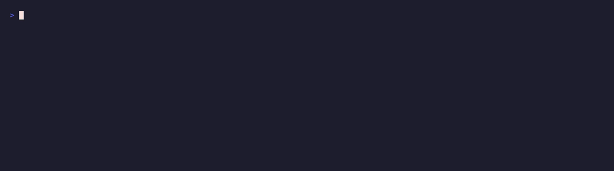
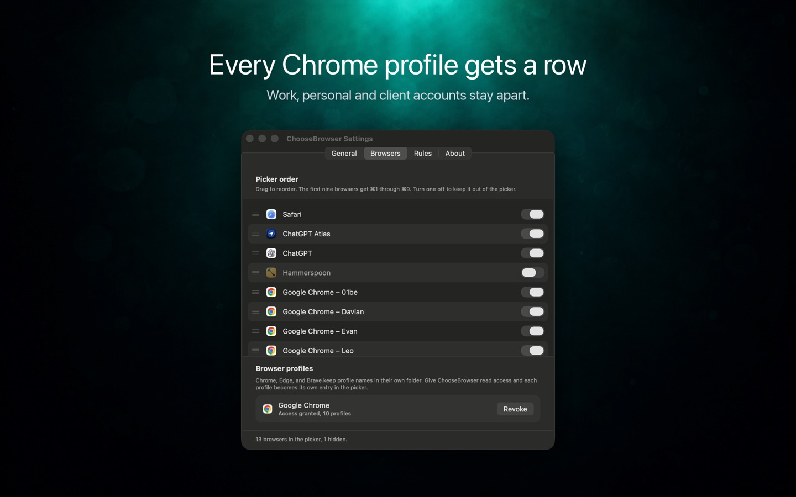

# chrome-use

**English** · [简体中文](README.zh.md)

<p align="center">
  <a href="https://github.com/leeguooooo/chrome-use/releases"></a>
  <a href="https://github.com/leeguooooo/chrome-use/stargazers"></a>
  <a href="https://bot-detector.rebrowser.net/"></a>
  
  <a href="LICENSE"></a>
</p>

<p align="center"><i>⭐ If it saves you a re-login, a star helps other devs find it.</i></p>


<p align="center">
  
  <br>
  <sub>Point it at a page in your <b>real</b> Chrome → get structured data in one command. <a href="assets/demo.tape">(regenerate: <code>vhs assets/demo.tape</code>)</a></sub>
</p>

<p align="center">
  <a href="https://github.com/leeguooooo/chrome-use/releases/download/film-why-chrome-use/why-chrome-use-en.mp4"></a>
  <br>
  <sub><b>Why chrome-use, in 5 minutes:</b> <a href="https://github.com/leeguooooo/chrome-use/releases/download/film-why-chrome-use/why-chrome-use-en.mp4">English (MP4)</a> · <a href="https://github.com/leeguooooo/chrome-use/releases/download/film-why-chrome-use/why-chrome-use-zh.mp4">中文 (MP4)</a></sub>
</p>

**chrome-use** drives your real, logged-in Chrome from any AI agent. It shares your existing login sessions and uses your existing browser profile; public detector results are documented, not a guarantee for every website. Part of the `*-use` family ([iphone-use](https://github.com/leeguooooo/iphone-use) drives your real iPhone; [bitwarden-use](https://github.com/leeguooooo/bitwarden-use) pulls passwords/2FA/passkeys from your Bitwarden vault so an agent can log in with credentials; chrome-use drives your real Chrome).

<sub>Originally based on [vercel-labs/agent-browser](https://github.com/vercel-labs/agent-browser) (Apache-2.0); now a standalone project. The stealth/extension-relay architecture, anti-detection, humanize, multi-agent isolation, and CLI have diverged substantially.</sub>

> 📚 **Documentation:** **[chrome-use.leeguoo.com](https://chrome-use.leeguoo.com)**: full guides, workflows & command reference (中文 · English).
>
> 📖 **Deep dive:** [Letting an agent click into cross-origin iframes: how chrome-use solves the hardest part of browser control](https://blog.leeguoo.com/en/posts/chrome-use-cross-origin-iframe/)
> · [Driving your already-logged-in real Chrome (CreepJS scores it 0% bot), 中文](https://blog.leeguoo.com/zh/posts/chrome-use-drive-your-real-chrome/)

<table>
<tr><td align="center" width="960">

**Advertisement · Available**

### Advertise here

Showcase your product here and support ongoing maintenance.

[**Ask about advertising**](mailto:leeguoooo@gmail.com?subject=chrome-use%20advertising%20inquiry&body=Product%20%2F%20company%20name%3A%0AProduct%20URL%3A%0APlacement%20%28README%20%2F%20website%20%2F%20both%29%3A%0ACampaign%20dates%3A%0ABudget%20%2F%20currency%20%28optional%29%3A%0A) · leeguoooo@gmail.com

</td></tr>
</table>


## Paid setup and project sponsorship

Need help connecting your agent to your signed-in Chrome or setting up a browser workflow? Email us with your environment, the workflow and expected result, and where you are stuck. We review feasibility and agree on scope, acceptance criteria and a quote before work starts.

[**Ask about paid setup**](mailto:leeguoooo@gmail.com?subject=chrome-use%20paid%20setup%20inquiry&body=Target%20website%20or%20app%20%28public%20information%20only%29%3A%0AWorkflow%20and%20expected%20result%3A%0AEnvironment%20%28OS%20%2F%20browser%20%2F%20agent%20client%29%3A%0ACurrent%20blocker%3A%0ABudget%20%2F%20currency%20%28optional%29%3A%0APreferred%20timeline%3A%0A) · [Discuss sponsorship](mailto:leeguoooo@gmail.com?subject=chrome-use%20sponsorship&body=I%20would%20like%20to%20support%20ongoing%20maintenance.%0APreferred%20contribution%20%28one-time%20or%20monthly%29%3A%0AAmount%20%2F%20currency%3A%0A) · leeguoooo@gmail.com

Want to support ongoing maintenance? Email us to discuss a one-time or recurring contribution.

Community bug reports and feature requests remain welcome on GitHub. Please keep credentials and private account data out of inquiries.

## Give your AI agent the browser you already live in

**No fresh Chrome. No re-login. No "are you a robot?" walls.**

chrome-use points **any** agent (Claude Code, Cursor, Codex, your own scripts) at the **Chrome you're already signed into everything on**. It clicks in *your* window, so you watch it work and grab the wheel the moment it hits a 2FA prompt or captcha. And because it's literally your real browser (over a one-click extension, native messaging, no debug port), the documented CreepJS test reported: **[CreepJS scores it 0% bot](#anti-detection).**

A **new browser context** starts without your existing login sessions. Playwright and Puppeteer also support persistent profiles and existing-browser connections; compare the actual configuration. **chrome-use** connects to your existing Chrome. Your cookies, sessions, and browser fingerprint are all real, because it IS your real browser. Chrome 136 restricts remote debugging of the default profile; prompts and requirements depend on Chrome version and connection mode. Our extension uses native messaging instead: **install once, then zero per-use confirmation.**

| | Typical automation (Playwright · Puppeteer · browser-use) | web-access / raw CDP port | [Claude in Chrome](https://www.anthropic.com/claude/chrome) | **chrome-use** |
|---|:---:|:---:|:---:|:---:|
| Works with **any** agent / CLI (not one app) | ✅ | ✅ | ❌ Claude only | ✅ |
| Drives your **real, logged-in** Chrome | Configurable; fresh contexts start empty | ✅ | ✅ | ✅ |
| Connect method / **"Allow remote debugging?" popup** | — (own browser) | `--remote-debugging-port` · version/mode dependent | `chrome.debugger` · no | native messaging · **never** ✅⁴ |
| Real-browser fingerprint (CreepJS ~0%)¹ | ❌ automation markers / headless | ✅ | ✅ | ✅ **verified 0%** |
| **No `Runtime.enable` CDP leak** (rebrowser)² | ❌ leaks | ❌ leaks | ✅ measured clean (2026-10-27) | ✅ **off by default** |
| Many agents on **one** real Chrome, isolated tab groups³ | ❌ separate browsers | ⚠️ shared tabs, no isolation | ❌ single app | ✅ |
| Permissions footprint | full control | full CDP | 16 incl. `<all_urls>` | **15, no granted host permissions** (`http/https` optional) |

<sub>¹ All three real-Chrome tools score ~0% on CreepJS (it's a real browser); we've measured ours. ² rebrowser's `runtimeEnableLeak`: verified clean on our relay path; Claude in Chrome measured clean (2026-10-27, 16 green / 0 red, see [bench/claude-in-chrome](bench/claude-in-chrome/)). ³ web-access can run parallel sub-agents on one browser, but without per-session isolation; each `--session` here gets its own colored, command-isolated tab group. ⁴ No consent dialog, but the extension still uses `chrome.debugger`, so Chrome shows its "started debugging this browser" bar while an agent tab is attached. See [Setup](#setup-connect-to-your-chrome) for removing it. See [Anti-detection](#anti-detection) for the measured numbers.</sub>

## How it works


Your **chrome-use CLI** talks to a tiny **browser extension** over Chrome
**native messaging**: a local inter-process channel, *no network socket, no
token, no remote server*. The extension uses `chrome.debugger` to drive the tabs
you target in **your own, already-logged-in Chrome**, then hands results back to
the CLI. Everything stays on your machine.


Each `--session` gets its **own colored Chrome tab group**, so multiple agents
can share one real browser concurrently without stepping on each other, or your
own tabs. When `--session` is omitted, chrome-use derives a stable per-agent
session from supported runner IDs, including Codex's `CODEX_THREAD_ID`.
Explicit `--session` / `AGENT_BROWSER_SESSION` always win. Session naming,
`session list` / `stop` / `prune`, ownership handoff, and daemon recovery are
covered in the [sessions guide](https://chrome-use.leeguoo.com/en/sessions.html).

## Install

**macOS / Linux**

```bash
curl -fsSL https://raw.githubusercontent.com/leeguooooo/chrome-use/main/install.sh | sh
```

**Windows** (PowerShell)

```powershell
irm https://raw.githubusercontent.com/leeguooooo/chrome-use/main/install.ps1 | iex
```

Downloads the prebuilt binary for your platform from the latest [GitHub Release](https://github.com/leeguooooo/chrome-use/releases) and installs `chrome-use`. No npm, no tokens.

<details>
<summary>Other ways to install</summary>

- **Pin a version:** `curl -fsSL https://raw.githubusercontent.com/leeguooooo/chrome-use/main/install.sh | AGENT_BROWSER_VERSION=v1.5.188 sh`
- **Custom location:** `curl -fsSL … | AGENT_BROWSER_BIN_DIR=$HOME/bin sh`
- **macOS app bundle:** on a Mac the installer puts `ChromeUse.app` (signed and notarized) in `<prefix>/share/chrome-use/` next to the bin directory, `~/.local/share/chrome-use/` by default, and `chrome-use` is a symlink into it. That way System Settings → Privacy & Security → Files and Folders lists chrome-use once, as "ChromeUse" with its icon, when an agent you run from the side panel works in a project under Documents, Desktop or Downloads. `AGENT_BROWSER_NO_APP_BUNDLE=1` installs the bare binary instead.
- **Windows, pin a version or location:** `$env:AGENT_BROWSER_VERSION = 'v1.5.139'` or `$env:AGENT_BROWSER_BIN_DIR = 'D:\tools'` before the `irm … | iex` line. It installs to `%LOCALAPPDATA%\Programs\chrome-use` by default and adds that to your user PATH, keeping the existing entries exactly as they were (opt out with `$env:AGENT_BROWSER_NO_PATH = 1`). No admin rights needed.
- **Windows, by hand:** download `chrome-use-win32-x64.tar.gz` and its `.sha256` from the [Releases page](https://github.com/leeguooooo/chrome-use/releases), check that `(Get-FileHash chrome-use-win32-x64.tar.gz -Algorithm SHA256).Hash` matches the `.sha256` file, extract with `tar -xzf chrome-use-win32-x64.tar.gz`, and put `chrome-use.exe` on your PATH. Check the hash before running it: an interrupted download still extracts into an `.exe`, which then fails at launch with an access violation (exit code `-1073741819`, `0xC0000005`) rather than anything that says the download was incomplete.
</details>

### Install with Nix

Run it once, no install: `nix run github:leeguooooo/chrome-use -- --help`.
The flake also ships a home-manager module and a NixOS module (`programs.chrome-use.enable = true`); on NixOS the native-messaging host is registered per-user, so run `chrome-use extension connect` once after switching (it registers the host the same way `extension install` does, then attaches to the extension relay).
Dev shell: `nix develop` (rust toolchain + node 24 + pnpm + chromium + vhs).
Full snippets: [install guide](https://chrome-use.leeguoo.com/en/install.html).

### Install the AI agent skill

With a current CLI, the installers install and verify its bundled discovery skill without Node, npx, Git or another download. To install or refresh it manually:

```bash
chrome-use skills install
chrome-use skills install --project
```

Global installation covers `~/.agents/skills`, Claude Code, Codex and Cursor, plus existing Pi, OpenCode, Windsurf, CodeBuddy and Trae configurations. It respects `CLAUDE_CONFIG_DIR` and `XDG_CONFIG_HOME`. Project installation uses `.agents/skills` and `.claude/skills`, plus existing `.pi`, `.windsurf`, `.codebuddy` and `.trae` configurations. Restart your agent or reload its skills afterward. A failed write is an error, even if other destinations succeeded. See [installation details](https://chrome-use.leeguoo.com/en/install.html).

**Claude Code, plugin marketplace (recommended):** installs the skill globally (all projects), auto-updates, and lists the rest of the [`*-use` family](https://github.com/leeguooooo/plugins):

```
/plugin marketplace add leeguooooo/plugins
/plugin install chrome-use@leeguooooo-plugins
```

**Additional runners:** [skills.sh](https://skills.sh) remains available for runners outside the built-in mappings. This alternative requires Node and its own dependencies:

```bash
npx skills add leeguooooo/chrome-use -g
```

> The install one-liners already install the bundled skill (opt out with `AGENT_BROWSER_NO_SKILL=1`). PowerShell also extracts it from older pinned CLI releases, bypassing their npx installer. Installation errors stop completion; the final message does not claim that the Chrome extension is connected.

> **Codex users:** Codex ships its own browser plugin and picks it for browser tasks. Measured on a machine with many skills installed, Codex also trims every skill description to a few characters (or none), so the skill's description cannot win the routing, and naming `chrome-use` in the prompt was not enough either. What worked was one line in the project's `AGENTS.md`:
>
> ```text
> Use the `chrome-use` CLI from the shell for every browser task; start with `chrome-use skills get core`. Do not use the built-in Chrome plugin for browser work here.
> ```

Either way the agent gets the right usage patterns and pre-approved bash permissions for `chrome-use`; the skill self-heals a missing binary by re-running the install one-liner above for its platform. Specialized guides (`electron`, `slack`, `agentcore`, …) are served by the binary itself via `chrome-use skills get <name>`, so instructions always match the installed version.

The installed discovery skill should direct the agent to `chrome-use skills get core`; it should not carry a second command manual. If an older installed copy contains its own workflow without that handoff, refresh it before comparing core-guide changes.

Upgrading the binary does **not** move a SKILL.md already copied into a runner; that copy lives outside the binary. `chrome-use upgrade` handles both: it installs the latest GitHub Release, then refreshes each installed copy of the skill it finds (Claude Code plugin, a git checkout, or the folders its installer writes; for an `npx skills add` copy it prints `npx skills update chrome-use`). `chrome-use upgrade --check` (or `--json`) changes nothing and reports current vs latest plus where the skill is installed; exit code 2 means the check failed. Other commands, and the native host whenever Chrome starts it, check for a newer release at most once a day in the background; when one exists they install it in place in the background (it takes effect on the next run) and refresh the skill copies. `CHROME_USE_AUTO_UPGRADE=0` turns off the automatic install and leaves a one-line stderr notice instead; `CHROME_USE_NO_UPDATE_CHECK=1` or the family-wide `USE_NO_UPDATE_CHECK=1` turns off the check altogether. A CLI installed where it cannot write (a package manager's path) is never replaced; it gets the notice and the command to run. The extension shows the same state in its popup and side panel, with an **Update CLI** button, and reports its own pending update there too. To refresh only the skill, run `chrome-use skills update` (`refresh` and `install` are the same command; add `--project` to install into `./` instead of globally).

### Use from an MCP client (Claude Desktop, etc.)

For hosts that speak **MCP but can't run arbitrary shell commands** (Claude Desktop, ChatGPT connectors, n8n/Dify), run chrome-use as an MCP stdio server by wiring it into Claude Desktop's `claude_desktop_config.json`:

```json
{
  "mcpServers": {
    "chrome-use": { "command": "chrome-use", "args": ["mcp"] }
  }
}
```

### Local agent side panel

Full guide: [Agent chat](https://chrome-use.leeguoo.com/en/agent-panel.html).

<p align="center">
  
</p>

Click the extension toolbar icon to open the side panel; **Settings** opens connection options. On macOS, Linux or Windows, choose **Codex**, **Claude Code**, **OpenCode** or **Pi** and use the installed CLI's existing login and provider configuration. The agent menu follows the connected host's capabilities; older hosts need an upgrade to offer newer adapters. Windows offers the same conversations, configuration preview/apply/restore, skills, images, options and schedules. Older Windows hosts need a CLI upgrade; no administrator access is needed. Agent processes run in owned Windows jobs, and private panel files use protected user/SYSTEM ACLs.

Codex uses its app-server protocol, Claude Code uses stream-json, OpenCode uses ACP, and Pi uses JSONL RPC. Each conversation has its own browser session. The current webpage appears as a tag above the composer and is attached to the next message so the agent can target that tab. Click **×** to leave it out of that message.

The model menu comes from the selected CLI's catalog. **Default model** keeps the CLI's configured model; a **Custom model ID** in the **＋** menu overrides the menu choice. **Reload models from CLI** refreshes the catalog. CLI version, account state and model listings do not prove execution access. **Agents & models** discovers programs and supports configuration previews, verified writes and restore that preserves later edits. Saving a default does not change a conversation already running.

The permission switch applies to one conversation. New conversations start with **Full access** enabled unless you have saved a different choice:

- **Codex / Claude Code:** turn it off for **Ask first** and review approval requests. Full access runs without those permission prompts and automatically answers supported approvals; agent questions still need your response.
- **OpenCode:** turning it off selects **CLI permissions**. OpenCode's own rules may allow tools without asking. Requests it does send appear in the panel; full access answers them with **Allow once** and does not change its stored permission rules.
- **Pi:** there is no per-tool approval mechanism. Turning full access off selects **Browser only**, exposing only the `chrome_use` MCP tools, without shell or file tools. Turning it on enables the CLI's full tool set.

History streams replies, expandable tool rows and requests. Tool output does not prove the browser task succeeded. Messages sent during a reply enter a queue; edit or remove them before they start, using **Load full text** for truncated previews. Failure or interruption pauses the queue until **Resume queue**. After a failed or interrupted turn, a new message starts immediately in the same conversation and model; older queued messages stay paused until you resume them explicitly. **Stop & send** or Ctrl/Cmd+Enter waits for confirmed interruption or process exit before sending ahead of the ordinary queue, which remains paused. Reconnect reads existing history without resending. An unconfirmed send can be retried explicitly with its original message ID; clearing its warning does not cancel a task that may already have arrived.

Panel replies preserve fenced code literally. To show an example containing triple backticks, wrap it in a longer fence. A closing fence must use the same character, be at least as long as the opening fence, and have only whitespace after it.

To delete a conversation, stop its response, click the header's delete button and confirm. Deletion removes panel history and that conversation's browser session, plus Codex rollout files, Claude session files/directories, OpenCode history through `session/delete`, or Pi session files inside the conversation folder. Codex's SQLite cache is left untouched. The panel reports cleanup failures or unconfirmed tab closure.

In the /resume picker, changing the agent or search clears the previous selection immediately. Enter only selects a currently listed session; it does nothing while results are loading, unavailable or empty. Changing the agent/search or closing the picker also dismisses old confirmations and prevents earlier resume responses from opening the old conversation. Requests already sent to the host may still finish; fresh results remain selectable while they are pending.

`/resume` continues a Claude Code, Codex, OpenCode or Pi session you started in a terminal, and a new conversation can work in a project folder that a site can remember. See [Continue a terminal session](https://chrome-use.leeguoo.com/en/agent-panel.html#resume) and [Project folder](https://chrome-use.leeguoo.com/en/agent-panel.html#project).

Each conversation row offers **Initial page**, **Final page**, and **Delete conversation**. Initial page opens the first recorded HTTP(S) URL; Final page opens the most recently recorded URL, including while a task is running. A matching recorded tab is focused, otherwise the saved URL opens in a new tab. Opening the initial page preserves the final address. Older conversations without an initial address report it as unavailable. The title switches chats; opening a page does not send messages, rerun tasks or restore unsaved input. Addresses stay in local extension storage. Deletion requires confirmation and reports cleanup failures; stop a running reply before deleting.

If Chrome replaces a saved Initial page tab, the conversation follows its replacement instead of opening a duplicate. The saved initial and final addresses remain separate.

Panel history is stored locally under `~/.chrome-use/agent-panel`, scoped to the Chrome profile. The selected CLI may send tasks and page content to its configured model service, whose privacy policy applies. The side panel adds no webpage content script; opening it can change the page viewport. Inspect & Ask (below) injects into a page only when you press its shortcut or button. Custom programs require an absolute path.

Clicking a task notification activates the conversation tab and focuses the window containing that tab, even when another Chrome window was last active or the current window is not yet known. A bound conversation tab takes precedence over the last-window fallback.

The panel also supports:

- **Skills:** type `/` to choose a bundled, user or profile-library skill. **Agents & models → Skill library** edits library entries, enables/disables them, and imports an absolute local folder, ZIP/.skill archive or HTTPS Git repository. User and CLI skill folders are read-only here. A selected skill and its assets are snapshotted before delivery, so queued messages and explicit retries retain the selected revision. Panel-bound agents can use `chrome_use_skills` to list/read skills, read selected relative text assets and save library instructions when asked.
- **Images:** paste, drop or choose up to five PNG/JPEG/WebP/HEIC files with **Attach images**. Chrome cannot decode HEIC, so the local CLI converts it to JPEG with the system codec (macOS `sips`; Windows needs the HEIF Image Extensions and HEVC Video Extensions from the Microsoft Store; Linux needs `heif-convert` or ImageMagick with HEIF support), applies the photo's rotation and drops its EXIF metadata, including GPS. Images are reduced to a 2000-pixel long edge and at most 512 KiB each before native transport. They stay with the conversation, including queued-message edits and retries, and are removed with it. ACP agents must advertise image input; unsupported input fails instead of dropping the images. The model service receives the attachments.
- **Conversation options:** choose allowed tools and, for Codex/Claude, reasoning effort; Codex also supports a service-tier override. Save while idle. Overrides take effect on the next response and do not edit CLI defaults. Codex can restrict writes but cannot remove its file-reading shell. OpenCode ACP does not enforce built-in tool restrictions; its own permission rules still apply. The approval switch controls automatic answers within the selected tool set; Pi has no per-call approvals.
- **Scheduled prompts:** **Agents & models → Scheduled prompts** saves intervals, daily/weekday local times or five-field cron, with agent, model, options, skill and explicit tool scope. **Run now** does not move the next scheduled time. Runs use independent background browser sessions and remain in history; completion notifications link to their conversations. The host-local service must be running; closing the panel does not stop it. On restart or wake, missed periods coalesce into one run. An active or unconfirmed run is never overlapped or replayed; inspect the history before acknowledging an unknown outcome. A chat cannot schedule more tools or automatic approval than it has, and scheduled conversations cannot mutate or trigger schedules or rewrite library skills for future runs. Native acceptance and agent completion remain separate from verifying the requested page effect.
- **Finish notifications:** when a panel task finishes, fails, stops, needs recovery or waits for your approval, Chrome shows a notification (outcome plus at most the first line of the redacted answer) and the toolbar icon counts the unseen ones. Clicking it opens the side panel on that conversation. Nothing is shown for the conversation the panel already has open in the focused window. Turn it off with **Settings → Notify when a task finishes**. Scheduled runs keep their own notification.

If Chrome rejects a panel turn notification, a later check in the same extension-worker session retries it. Disabled notifications and turns already being viewed remain suppressed. Viewing a turn while its notification is being created also consumes that turn if creation later fails, including across worker restarts.

### Inspect & Ask: click an element, let your agent change it

Press **Alt+Shift+C** (or **Inspect element** in the toolbar popup), click an element, write what should change and press Enter. chrome-use sends your words, the element's source `file:line`, a cropped screenshot and its styles through [ocs](https://github.com/leeguooooo/open-cross-session) to the Claude Code, Codex or Pi session already running in that project. It works on local dev servers and on test-environment domains in your logged-in Chrome.

- **Source locations** come from [code-inspector-plugin](https://github.com/zh-lx/code-inspector)'s `data-insp-path` marks (Vite, webpack, Rspack, esbuild, Turbopack; React, Vue and more). React 18 and Vue dev builds work without it; otherwise the message says "no source location" and carries selector and text. When marks are missing, the panel lists the exact changes and asks before your agent adds the plugin. Test builds need an explicit flag, never production.
- **Multi-select and markup:** Shift+click or drag to select up to 8 elements, ↑/↓ for parent/child, P to pause animations, a note per element, and a pen on each screenshot. **Copy** gives the same content as Markdown without ocs; **Open in editor** opens the file in VS Code, Cursor, Windsurf or WebStorm.
- **Project and session** come from one confirmation card per site (or per path), preselected only from local evidence: a committed `.chrome-use/inspect.json` naming the site's domains (single-label wildcards allowed), or the local dev server's folder, with exactly one session in that project. A session can also claim a site with `chrome-use inspect link <url>`; a claim on a site that belongs to another session waits for your OK in the panel. Choose **Only this tab** for a one-off target. Different worktrees stay separate; page data only ranks candidates.
- **Delivery is never replayed.** Each batch has an id; ocs's stored and wake results are shown separately, and an unconfirmed outcome is queried, not resent. Full context lives in `~/.chrome-use/inspect/ctx/<id>/` (owner-only, removed after 7 days); only a tombstone with the batch id and outcome stays, so an id is never sent twice.
- **Boundaries:** off by default; nothing stays injected in pages and no debugger bar appears. The input box runs in the extension's own frame, authenticated with a one-time secret, so page scripts cannot read or change what you type; each send re-checks that the box is fully visible. Page content is labelled as untrusted data, and delivery never raises the receiving session's permissions.

Details: [Inspect & Ask docs](https://chrome-use.leeguoo.com/en/inspect.html).

### Teach by demonstration: do it once, replay it with no model

```bash
chrome-use open https://shop.example/cart && chrome-use teach start --name checkout
# ...do the flow by hand in that tab...
chrome-use teach stop                       # ~/.chrome-use/teach/checkout.json + the steps, for review
chrome-use teach replay ~/.chrome-use/teach/checkout.json --arg-env password=SHOP_PW
```

`teach stop` writes a `chrome-use script` op-list: semantic locators first with CSS fallbacks in `or`, keystrokes merged into one fill, waits after page changes, and a final URL check. `--adapter` writes a site adapter skeleton instead (`args.ui` input, `--until-done`). Passwords, card numbers and one-time codes are never recorded; they become `--arg-env` parameters. The side panel's **Record** button does the same for its tab and shows the steps before saving. The recorder runs in an isolated world with a binding only that world has, so pages see nothing, stealth mode included. Details: [Teach by Demonstration](https://chrome-use.leeguoo.com/en/teach.html).

## Setup: connect to your Chrome

Install the [**chrome-use** extension from the Chrome Web Store](https://chromewebstore.google.com/detail/chrome-use/knfcmbamhjmaonkfnjhldjedeobeafmk), then register the local bridge once:

```bash
chrome-use extension install      # register the native-messaging host (one-time)
chrome-use open https://x.com/home
chrome-use status                 # relay, profile, extension, and session health
```

On macOS/Linux, `chrome-use extension install` also registers the native host in existing custom data directories of running Chromium-family browsers started with `--user-data-dir=<path>`. For a browser that is not running or cannot be discovered, use `chrome-use extension install --user-data-dir "/path/Chrome Data"`; `--user-data-dir=<path>` is also accepted and the option may be repeated. Every explicit directory must already exist. The command lists written manifests and reads back their name and launcher path. This confirms registration only: reopen the side panel in that Chrome or wait for automatic reconnection. Windows uses HKCU registration and rejects this option. Discovery scans only the current user’s processes. Failures in discovered directories warn and skip that registration; default and explicit directory failures remain errors (retry with `--user-data-dir`). Successful custom registrations are recorded in `~/.chrome-use/custom-host-dirs.json` for status and uninstall even when the browser is stopped. Recording failures warn that uninstall may leave manifests behind.

`chrome-use open` then drives your real, logged-in Chrome over **native messaging**: no debug port, no token, and **no "Allow remote debugging?" dialog, ever**. The raw remote-debugging-port alternative (which pops a consent dialog) is described in the [real Chrome guide](https://chrome-use.leeguoo.com/en/real-chrome.html).

On macOS/Linux, the generated native-host launcher keeps the installation's
`HOME` and optional absolute `CHROME_USE_RELAY_DIR`, even if Chrome starts it
with a different environment. Without an override at installation it clears an
inherited relay override. To refresh an existing launcher, rerun `extension
install` with the intended environment; private rigs should also pass
`--no-open --no-profile` and set `CHROME_USE_NO_BROWSER_SCAN=1`.

`browsers --who <domain>` inspects cookie names on disk, never values; presence
is not proof that a session is still accepted. On macOS, SQLite reads use the
PATH `sqlite3` first and fall back to `/usr/bin/sqlite3` only when it cannot
start because it is missing or has an unsupported executable format. Execution
permission denials and errors from an already-started SQLite query remain
explicit errors; locked or corrupt databases are not retried with another tool.

`extension install` is the one-time setup. `chrome-use extension connect` (alias `chrome-use reconnect`) re-attaches to an already-installed extension's relay without reinstalling anything. Chrome still shows its "chrome-use started debugging this browser" bar on attached agent tabs; `chrome-use extension connect --silent` removes it by restarting Chrome once with `--silent-debugger-extension-api` (tabs and logins are restored; it refuses when several Chrome instances are running). `--keep-banner` leaves Chrome alone, and without either flag it asks first in an interactive terminal.

All AI sessions in a Chrome profile share one background agent window, with one tab group per session; your own window stays separate. Existing windows with verified agent ownership are reused, including fullscreen windows. Unknown ownership or failed placeholder cleanup refuses instead of creating more windows. User tabs are never moved or deleted to reclaim a window. If you open or drag your own tabs into the agent window, that window becomes yours: agent tabs already there keep working, and new agent tabs go to one fresh agent window that later sessions share.

Browser commands normally require an open window in the selected Chrome profile. If its relay is down while Chrome is running and Local State does not list that profile as active, recovery first waits for the same profile to remain unlisted for 20 seconds. This gives a recently opened window or relay time to finish starting; active or unknown metadata cancels the pending window request. Recovery then requests one profile window and checks again 20 seconds after that request, within the existing 45-second relay wait. Opening a window does not prove the relay connected. This recovery can briefly bring Chrome to the foreground on macOS. Focus restoration is best effort; it does not guarantee returning to another Chrome window. This exception applies only to profile recovery; ordinary tab actions stay in the background. `status` only reads metadata and never opens a window. `AGENT_BROWSER_NO_AUTO_RECONNECT` disables automatic recovery. Missing or malformed metadata does not trigger a window request. An ambiguous process command line still counts as a running user browser; only a clearly separate automation instance on another data root is excluded. If recovery still cannot connect, follow the reported profile or relay error; do not restart Chrome merely because its relay is down.

A relay timeout means a command missed its deadline. Tab metadata cannot prove
blocked JavaScript or a healthy command channel; screenshots can remain pending
while JavaScript answers. Preserve the tab, inspect `status` and `tab inspect <ref>`,
avoid overlapping capture retries, and verify an action's effect before repeating
it. If the probe also fails, inspect its reason before treating the tab as closed.

### Multi-profile Chrome: ChooseBrowser rules

If you keep several Chrome profiles (work, personal, a client's), you already know which account each site belongs to, and you tell us with `--browser` every time. [ChooseBrowser](https://choosebrowser.leeguoo.com) is a macOS link router that stores that mapping. When it is installed, `chrome-use open <url>` without an explicit `--browser` follows the rule you already wrote for that site, and says so:

```
$ chrome-use open https://github.com/my-org/repo
· using Chrome profile Profile 14 — a ChooseBrowser rule routes this site there
  (github.com|/my-org*). Override with --browser <id|email>, or skip with
  --no-choosebrowser.
```

Read-only, and invisible if you do not use it: no rules file means no behaviour change and no message. A rule is binding: chrome-use never opens the site in a different profile. If the rule's profile is not connected, the command fails and names `chrome-use connect --browser <profile>`. If the session is already bound to another profile, it fails and suggests a new `--session` or `--no-choosebrowser`. `--browser` and config routes still win. The check covers `batch` steps, MCP tool calls and script steps as well as direct commands. A rule whose profile no longer exists only warns. `chrome-use doctor` lists each rule and whether its profile is connected. Add `--remember` to an explicit `--browser` and chrome-use asks ChooseBrowser to write the rule back, behind its own confirmation dialog.

<a href="https://choosebrowser.leeguoo.com"></a>

**ChooseBrowser** is a macOS link router by the chrome-use author. Set it as your default browser once, and every link you click asks which browser, or which Chrome profile, it should open in.

- A row for every profile in Chrome, Edge, Brave, Vivaldi or Chromium; work, personal and client accounts stay apart.
- Rules that match a path, not just a domain, so one site can route to two browsers.
- `⌘1`–`⌘9` opens instantly, `⌥↵` teaches it once, and it learns which browser you prefer per site.
- No accounts, no tracking, no analytics. Optional sync through your own iCloud.

Free for 7 days, then **US$4.99 one-time for up to 3 Macs**. Notarized `.dmg`; macOS 26 or later. [Download](https://choosebrowser.leeguoo.com) · [Full guide](https://chrome-use.leeguoo.com/en/choosebrowser.html). chrome-use does not depend on it.

<br clear="all">

## Usage

After cross-site navigation or reconnecting, page reads use the current document. If the page keeps changing while its private reading context is being recreated, the read fails explicitly; observe the page again before acting.

`chrome-use mobile serve --bind IP:17345` waits with exponential backoff (1–60 seconds) when that IP is unavailable. It keeps the exact address and reports readiness only after listening succeeds. Update `--bind` and the phone endpoint after changing networks; it never switches to all interfaces automatically. Other bind errors fail immediately.

Custom comboboxes are scrolled into view instantly and opened with trusted pointer input. `pick` reports `verified: false` with a warning when the choice is unconfirmed. Page/container scrolling uses instant movement even with CSS smooth scrolling; an unchanged position returns `scrolled: false` with a warning.

A wait-condition timeout alone does not diagnose a browser connection failure. `wait --text` matches a case-sensitive substring: use the actual page wording, and do not wait again after the requested receipt is already visible.

`chrome-use skills get core` includes the everyday action loop and ordinary form commands. Load `core/reading`, `core/connection`, or `core/site-adapters` only when that task needs the detail; an ordinary click does not require another reference. Use the cheapest state check that answers the next question, and stop once an authoritative page signal confirms the goal.

The core loop: open, read, act, re-read only what changed.

```bash
chrome-use open https://example.com    # connect to your Chrome and navigate
chrome-use snapshot -i                 # the start of every interaction: interactive elements with @refs
chrome-use click @e3 --observe         # act, and watch for the page's reaction
chrome-use snapshot -i --diff          # only what changed since the last snapshot
```

For scoped, depth-limited, regex-filtered or budgeted snapshots, JSON `refs` contains only references rendered in the returned excerpt. The session keeps its complete live ref map; narrowing output does not invalidate a previously captured ref. Sparse-page detection still uses the complete map. Valid incremental snapshots return JSON `refs` only for nodes in the delta. A no-change delta has empty `refs`; the complete live session map and previously captured refs remain available. A full-tree fallback keeps the normal full-snapshot behavior.

Interactive snapshots add `context` only to repeated controls with the same role and name when named parent lines do not already distinguish them. Context omits the control’s own name and punctuation, stays within about 100 characters (60 for unnamed controls), and must differ between controls. Unique controls have no context; use a scoped or full snapshot for missing details such as a unique product’s price.

Scroll-driven animations use percentages instead of finite time durations, so they do not
hold the settle wait open. Finite time-based animations, DOM changes and in-flight
requests keep their existing checks.

Prefer `snapshot -i -c` for compact controls, scoped reads for a known region, and `--diff` only when the last observation leaves a question. Use `batch` for known action sequences (a step takes its own `--observe`: `batch "fill @e1 Ada" "click @e2 --observe"`; `pick` and `hover` observe like `click`), `script` for bounded observe/decide/act/verify flows, and `form fill --map` for several fields. Verify the requested result at the end: `observed.status: complete` means the capture is complete, not the task, so wait for the page's own final signal (`wait --text`). On a small page (tree at most 4 KB and 60 lines) an observation carries the whole current tree as `observed.snapshot` plus `observed.changes` (`+`/`-` lines only); larger pages keep `delta`. `observed.text` lists visible text lines that changed in any frame (receipts, logs, page counters), never input, textarea, select or editable content, and nothing at all while any password field holds a value (`textStatus: redacted`); a frame it could not read is listed in `textFrames` and makes the observation `partial`. `observed.target` names the tab and target on every JSON reply. `observed.announced` holds the text of toasts and alert/status/aria-live regions that appeared while the action ran and the page settled, even ones gone before the reply ("video under review, not saved"). An element screenshot is `screenshot <selector> <path>` or `screenshot <path> --selector <selector>`. Add `--with-screenshot <path>` only when pixels answer a question the tree cannot.

After a successful trusted insertion, contenteditable `fill` keeps focus on the editor without synthetic `change` or `focusout` events. If read-back fails, it reports the failure instead of overwriting the editor DOM. Use the page's own save or commit action when needed.

`dblclick` uses two trusted pointer clicks and verifies delivery to the target. Covered, disabled, transformed-frame and unmappable cross-origin targets are refused; no synthetic fallback is used. If the target changes after the first click, the second is stopped. JSON includes `dispatch: "pointer"` and `verified`; an unverified delivery carries a warning. Inspect the page before retrying an interrupted or unverified action. `AGENT_BROWSER_CLICK_MODE=dom` is not supported for double-clicks.

When a hidden Monaco module API can be matched to the requested editor, `fill` uses native input and verifies that exact live model (`engine: monaco-native`); `get value` reads the same model without copy or paste. This path does not use the system clipboard. The same path covers completed exports retained by the Monaco 0.52 minified AMD loader after its public globals are removed. Discovery reads a bounded module table without invoking the loader, module factories or accessors; it does not load modules or make requests. The native select-all must cover the complete live model before insertion. A changed model, lost focus, incomplete selection or mismatched readback is an error, with no clipboard retry after input. If no exact model API is found, `fill` and `get value` refuse before clipboard access. Only after the user accepts temporary system clipboard changes, add `--allow-clipboard-fallback` to that command. The flag is supported only by these two commands, is not persistent, and never permits fallback after native input or model verification fails. The opted-in fallback emits a warning: comparison/restoration is not atomic and can overwrite a concurrent clipboard write. Monaco clipboard fallback keeps transaction state in a private closure and removes temporary listeners on completion, setup errors, or a 60-second lease expiry while the document survives. The backup uses independent Blob-backed items because browser-backed ClipboardItems may expire after a write. An empty or unreadable backup is refused before staging. Contents are compared before further input and before restoration; changes or uncertain ownership stop the operation. Restoration is read back and verified. Only formats exposed by the Web Clipboard API can be backed up; native application metadata is not preserved. A restore failure is an error, even if the editor changed. Context loss can prevent restoration, and clipboard comparison/write is not atomic; avoid concurrent clipboard use.

Place the opt-in after the required text/selector, as the last option; `--` ends editor option parsing, and a mandatory fill value equal to the flag remains literal text. Clipboard action-policy and confirmation rules still apply. Approval never overrides a hard deny, and extension-held site requests require the user’s actual extension decision. Approval for document, input and clipboard operations binds the original owned target and fresh HTTP(S) renderer security origin; missing or opaque origins refuse. Explicit HTTP(S) navigation binds its original target (if any) and immutable destination, so approval works from about:blank or a cold start. The existing `tab new` API accepts HTTP(S) or its default about:blank, and `window new` creates only its declared about:blank target. These creation commands bind their action and destination and create a new owned target after approval. A nonblank window URL is refused; use `tab new <https-url>` for a URL. With no original owned target or with `--new-tab`, it creates a new owned target and preserves pages that appeared while approval was pending. For a named navigation target, first select it with `chrome-use tab <target>`; approval refuses an active-target mismatch. JavaScript URLs and in-page SPA actions require document-origin verification. `read <http(s) URL>` binds the original URL and arguments independently of browser presence. An explicit HTTP read URL uses no tab routing or forced adoption; reads without a URL still depend on the current document for approval. HTTP resources use the `read` category; file domain rules are checked even without a browser. Field policy checks use the intended target’s saved refs and iframe sessions; missing or unreadable context refuses before input.

`screenshot --annotate` draws numbered labels into the captured image in the CLI, without inserting page nodes or styles. JSON annotation boxes remain capture-relative CSS pixels; labels scale to the image resolution. Explicit clips take precedence over full-page and selector captures. Frame references use their owning renderer and top-viewport geometry. Nested out-of-process frames support rotation, skew, reflection and perspective through protocol quads and isolated-world viewport measurements, including scrollbar space. Annotation boxes enclose the projected corners. Collapsed or ill-conditioned transforms, perspective-horizon crossings and missing frame geometry report errors instead of guessed positions. Cropping also happens in the CLI; an off-viewport region is cropped from a full-page capture. Regions outside the page are refused.

Ordinary selector and `--clip` screenshots use the same CLI pixel-cropping path, including after page scroll. Viewport regions capture the existing surface; off-screen regions capture the full page before cropping. Neither path scrolls or activates the tab.

The extension relay allows up to 25 seconds for each screenshot capture, below the CLI's 30-second CDP deadline. Native captures after viewport or DPR changes can take longer than ordinary commands. This waits for the same capture; it does not replay it or activate the tab. A timeout still fails and does not cancel Chrome's pending capture, so avoid overlapping capture retries. Background-color cleanup uses the existing attachment once, without resetting it or retrying on another target. Ordinary commands retain their normal recovery behavior.

Windows relay `screenshot` requires extension 0.5.101 or later for minimized-window detection. A minimized target window is refused before capture. `--allow-window-restore` explicitly permits restoring only the bound tab’s existing window to normal; it requests `focused: false`, leaves the window restored, and may change focus. It never activates a tab or creates a window. A changed target or unverified restoration fails instead of retrying. JSON includes `windowPreparation`. This option is unavailable outside Windows relay; older extensions retain legacy default capture behavior with a warning.

| Screenshot option | Effect |
| --- | --- |
| `--allow-window-restore` | Permit Windows relay window restoration for this screenshot |

```sh
chrome-use screenshot report.png --full --allow-window-restore
```

The extension relay attaches to nested out-of-process iframe targets recursively, so snapshots can resolve their contents up to the existing three-level expansion limit. Chrome must allow debugger access to each target. If a frame or ref is missing, inspect `frames` and take a fresh snapshot; do not guess another target.

For Ant Design / rc-picker date ranges, fill the start bound and then the end bound. `fill` confirms each bound through the component's trusted keyboard or visible confirmation control and reads it back, instead of blurring and refocusing a draft. Focus follows the picker. Invalid, read-only or disabled controls fail without a synthetic overwrite; an unverified popup requires explicit picker interaction. Verify the final range before running the query.

If only the post-action capture fails, `observed.refs` says what became of the refs: `kept-unverified` keeps the previous snapshot's refs, but each is confirmed live (same tab, frame, document and element) before a later command uses it and refused otherwise, never re-anchored by role or name (DOM-walk refs are always refused then); `dropped` means the document may have changed. Either way, run `snapshot -i` and do not repeat the action.

Semantic `find role/text/label/placeholder/alt/title/testid` requires exactly one visible match, including locate-only queries. Ambiguity returns up to eight candidates with visible state and selector/context hints; no action is dispatched and input values are omitted. Narrow `--name`/`--exact`, or use `--within <CSS|@ref>` to restrict the query to exactly one container. A scope must belong to the active tab's main document; cross-frame refs and an explicitly selected iframe are refused; use direct frame refs or `frame main`. `find first/last/nth` explicitly selects an order and keeps its existing behavior. A plain CSS selector or XPath given to an action (`click`, `fill`, `type`, `hover`, `check`, `select`, `drag` …) must match exactly one element too: one that matches several is refused with code `selector_ambiguous`, listing the first five matches with their text and position, and nothing is done. Narrow it, use a `@ref`, or choose by index with `find nth <index> <selector> <action>`; `AGENT_BROWSER_STRICT_SELECTORS=0` (read when the session's daemon starts) restores first-match for old scripts. Roles and label names use Chrome accessibility data, including `aria-labelledby`; a semantic query re-resolves on each call. A detached target before dispatch fails safely; uncertain actions are never replayed.

Semantic clicks report the covering element with a bounded tag, id/class and text description. If the hit-test cannot confirm the target, the click fails without guessing a blocker or dispatching input.

The existing `chrome_use_find` tool in `mcp --tools all` accepts `within` with the same unique-scope rules; tool count is unchanged. `text` for fill/type is passed literally, including `--name --observe`, rather than parsed as CLI options.

Semantic find retains the existing `--observe` unsupported warning; use one `batch` containing the scoped find action and a task-specific `get text` receipt when both are known. The MCP find tool does not advertise an observe field.

Discover a scope from the page first: `find query "Beta account"` returns candidate selector anchors; choose the article/container corresponding to that heading, then use `find role button click --name Save --exact --within "<returned-selector>"`. Inspect an ambiguous scope with `snapshot -s "<selector>"` and narrow it rather than accepting the first container. Unknown semantic-find options and duplicate `--within` are refused; use `find label Email fill -- --name` to enter literal flag-looking text. `--exact false` requests substring matching.

After three identical observed `click`, `dblclick`, or `press` attempts on the same target and screen, with no gap over 60 seconds, `observed.noProgress` advises checking state or waiting for a task-specific condition. It requires complete, settled evidence with no detected tree, request, resource, or frame activity. The hint does not change action success, prove a write failed, or retry it.

Ordinary CLI/MCP connection preparation preserves this streak only on successful reuse of the same browser connection, target and session, without loading storage state. A new browser, rebind, failed preparation or storage-state load still clears the count.

Scripts retain these hints in `advisories` (top-level in CLI `script --json`; `data.advisories` in the daemon envelope) (at most 20), including nested scripts and runs that later fail. JSON op-list scripts also keep `noProgress` on the relevant `steps` entry; text output prints the aggregate advisories once. A failed JS script retains `ok:false`, `return:null`, `error`, `logs`, and `advisories`. Nested script daemon-envelope `data.ok:false` fails the parent script even when transport `success` is true; dispatch success does not establish program success.

Scripts pause at approval with `ok:false`, `confirmation_required:true`, the approval ID and prior operation trace; the CLI exits 3. JSON `optional`/`or` and JavaScript catches cannot advance past a held gate. Later bridge calls are blocked for that execution, including raw bridge calls. Existing `autoConfirm` may answer a command prompt, but a second native gate or refusal stops the program. Approve outside the paused execution, then continue only the remaining operations. A named JavaScript context starts a fresh execution next time; this does not approve or consume the held request.

JSON refusals after `autoConfirm` carry `approval_refused:true` through nested programs; outer optional steps and catches also stop further browser calls. Ordinary errors and initial direct denials retain explicit optional/catch handling.

Ordinary CLI `--json` replies use a `success`/`data`/`timing` envelope; `--no-timing` (or `AGENT_BROWSER_TIMING=0`) leaves `timing` out for a compact reply, and `timing.jsonl` is still written. `batch --json` prints an array of `{command,success,result,error}` entries; `script --json` prints the bare program result (`ok`, `return`, `logs`, `error`, `advisories`, and other program fields). Batch and script CLI output have no top-level `timing`. A pending confirmation stops the batch immediately, with or without `--bail`, and exits 3. The last result keeps the approval instructions and confirmation ID; later steps are not sent. After approval, inspect the result and start a new batch for any remaining work.

MCP `chrome_use_snapshot` accepts `diff: true` for a reread of the same page with the same snapshot options, including the filter. It maps to CLI `snapshot --diff`. Without a valid baseline it returns the full tree and `diffNote`; omit `diff` or set it to false when a complete current tree is required. A diff is an excerpt, so keep its baseline and do not interpret a removed line as a current control.

A click refused by the hit-test guard reports `element_occluded` with `retryable: false`, even when the covering element says "timeout" or "connection". No click was dispatched. Read a fresh snapshot and resolve the blocker before trying again; repeating the same command does not resolve an overlay.

JSON command timing includes `cdpMs` (sum of completed foreground CDP request durations), `cdpBusyMs` (their interval union within command wall time), and `nonCdpMs` (wall time minus that union). Concurrent requests can make `cdpMs` exceed wall time; these are elapsed durations, not CPU measurements. Background tasks do not inherit the recorder; `nonCdpMs` is not pure daemon processing time. Tool/HTTP calls are not model round trips; only caller traces establish those. See [task measurement](https://chrome-use.leeguoo.com/en/core-loop.html#task-efficiency) for task measurement.

The agent operates in your Chrome: you'll see tabs opening, pages loading, clicks happening in real time. You can take over at any point (e.g. solve a CAPTCHA), then let the agent continue.

For an authorized task, the bundled skill tells the agent to inspect and attempt ordinary CAPTCHAs before handing off: `solve-slider` for ordinary and rotating Yidun puzzles, screenshot-guided ordered clicks for readable icon challenges, then verify the site's result and continue. Load `chrome-use skills get core/captcha`. Attempts are bounded; unavailable or ambiguous challenges still need a handoff. This workflow does not guarantee every provider or challenge can be solved. Activate the target before capturing coordinates; a provider success or frozen resend countdown does not establish site acceptance.

Regular Human pointer clicks now use a seeded 60–200ms settling pause after movement and before pressing. Fast and Off keep their existing timing. Human selector/ref clicks recheck the same live element at the landing point after the pause. A verified top-level `@ref` hidden by a small fixed/sticky semantic edge header/navigation bar may use one trusted wheel gesture toward a clear position. The gesture is bounded to 10 seconds, uses humanize pacing, and keeps the original live handle and document epoch. Unknown wheel points, transport failures and context changes stop without a DOM-scroll fallback or input replay; the same element must pass the final exact hit-test. The default trusted path still refuses dialogs, modal/popover blockers and unverifiable targets. `click stopped before press` means no mouse button was sent; inspect before retrying, because the pointer or viewport may have moved.

| Command | Purpose |
|---|---|
| `--humanize off\|fast\|human` | Fast is the default; Human regular pointer clicks add a seeded 60–200ms settling gap and recheck the live target before press |
| `--allow-focus-recovery` | Allow one Windows relay native Escape recovery for this command; may change focus |
| `chrome-use extension install --user-data-dir <path>` | macOS/Linux: register an existing custom Chrome data directory (repeatable; equals form accepted). Running custom directories are also discovered automatically. Windows uses HKCU and rejects this option. |
| `--window user` (default) / `--window dedicated` | Extension relay: AI tabs open in your current window, each session in its own tab group starting with ✦; `dedicated` moves all AI sessions into one shared background window per profile |
| `chrome-use open <url>` | Connect to your Chrome and navigate. If `load` has not arrived after 25s but the tab's page is clearly usable, it succeeds with a ⚠ warning; when that page can't be tied to this request (always over the extension relay) the reply carries `commit: "unverified"` and the tab's real URL. A page that isn't usable fails with `navigation_incomplete:`, saying what is known (commit, readyState, candidate resources) |
| `chrome-use snapshot -i` | Read the page after settling; ignores scroll-driven animation timelines (`-u` adds absolute link URLs) |
| `chrome-use read --links` | The page as text, plus a bounded `## Links` list of `[text](absolute URL)` (first 100, `--max-links <n>` up to 1000) |
| `chrome-use click "Post"` · `click @e3` · `click 449 320` | Click by text, by snapshot ref, or on a raw viewport coordinate |
| `chrome-use fill "Title" "Hello World"` · `type @e3 "text"` | `fill` replaces a whole value and `type` appends, both with trusted input events; a ⚠ warning says when the page did not react (e.g. its Save stayed disabled) |
| `chrome-use extract --schema '{"rows":".item","fields":{"title":"a","url":{"sel":"a","get":"@href"}}}'` | Structured rows in one call; `"@href"` alone reads the row element's own attribute. A spec it does not understand is an error, and a field empty in every row is named in a ⚠ warning, never a silent null |
| `chrome-use hover @e3` | Move the real pointer onto the element (trusted input); ✓ only when a trusted pointer event landed on the element, and a covered target is refused instead of hovered |
| `chrome-use network request <id>` | Read the recorded response body from its originating renderer, including cross-origin frames; unavailable bodies carry `responseBodyError` |
| `chrome-use screenshot ./page.png` | Save visual evidence; use it for image challenges and canvas targets, and refs for ordinary controls |
| `chrome-use solve-slider 1` · `skills get core/captcha` | Attempt a Yidun puzzle (nonzero exit if unsolved); load ordered clicks and verification |
| `chrome-use find "edit web service settings button"` | Ranked, non-acting candidates from a natural-language description |
| `chrome-use actions @e15` · `do @e15 expand` | What this element supports right now, and perform one of exactly those |
| `chrome-use click @e2 --follow` | A tab the click opened (`target=_blank`, `window.open`) is reported as `openedTab` and joins the session; `--follow` moves to it. In your own Chrome only tabs opened by the session's tabs are taken, attached by tab id (ab-connect 0.5.30+); otherwise `openedTabWarning` / `openedTabStatus` (`unadopted`, `unknown`) say why. A tab opened from a tab the session does not own (`tab adopt`, `--tab … --force`, the side panel on your tab) stays yours: reported, `followed: false`, taken with `tab adopt <url>`. A tab the page opens brings Chrome to the front over your app, and `openedTabWarning` says so; on macOS chrome-use puts your app back in front (`focusRestored`; `AGENT_BROWSER_RESTORE_FOCUS=0` turns it off). `AGENT_BROWSER_BACKGROUND_LINKS=cross-site` (the default while agent tabs share your window; `off` turns it off; read when the session's daemon starts) opens cross-site `target=_blank` links in a background tab instead (`openedTabMode: background`); cost: a link that redirects back to the page's site loses its `SameSite=Strict` cookies |
| `chrome-use tab list` · `tab select t2` · `tab adopt <url-substring\|targetId>` | List tabs; select a created or adopted tab; attach an already-open tab through the extension or direct CDP without navigating it |
| `chrome-use tab new [url] --activate` · `tab select t2 --activate` · `tab adopt <targetId> --activate` | Raise the target before initialization or the liveness probe; `--front` is an alias |
| `chrome-use tab list --all [--limit <n>]` | Every tab in the connected Chrome profile, across windows, the user's own and other sessions' included: handle, window, active, title, url, owner (this session / `session <name>` / the user). Read-only even on the first call: no daemon, window, tab or page attachment is created. Urls are as Chrome reports them and may carry tokens |
| `chrome-use --tab <handle> --force <command>` · `tab close <handle> --force` | Act on (or close) a tab the session does not own, such as the user's own, in place and in the background; only when the user asked. Results carry `forced: true` with the tab's title and url; `close` never closes a forced tab |
| `chrome-use set device "iPhone 13"` · `set device off` | Emulate a device, or clear metrics, user-agent and touch overrides; `device off` is an alias |
| `chrome-use dialog status` · `dialog accept\|dismiss` | Handle a native `confirm()` / `prompt()` opened by a click |
| `chrome-use download @e2 ./video.mp4` | Download with the same cookies as the logged-in browser, without navigating the current tab |
| `chrome-use network route "*/api/me" --body '{"vip":true}'` | Mock a response, rewrite an outgoing request, or block one |
| `chrome-use site github/issues epiral/bb-browser --json` | Run a site adapter and get clean JSON from the site's own API. If the current URL cannot be read, `site_domain_unverified` stops domain navigation and fallback; check `get url` and `snapshot` before retrying |
| `chrome-use site info github/issues` · `site info github` | Show one adapter's args and domain, or every adapter in a pack with its args and a usage line |
| `chrome-use tab close t2` · `close` | Close a tab, or end the session and close every tab it created. Both read the tabs back before reporting them closed (`tabsClosed`, `verifiedAbsent: true`); a tab still open or not confirmed gone fails with `close incomplete` and keeps the session and its tab ownership for a retry. `tab close` on the session's last tab ends the session (`sessionClosed: true`). Tabs the session did not create are never closed. Confirming over the relay needs ab-connect 0.5.33+ |
| `chrome-use session list` · `session stop [name]` | Manage session workers |
| `chrome-use auth login --bwu [--item <id\|name>]` | Fill the current login page from Bitwarden; handles TOTP and supported passkey second factors |
| `chrome-use auth login --bwu --passkey` | Sign in with a vault passkey in `--launch` mode (bwu 0.9.0+) |
| `chrome-use status` | Relay transport, recent debugger timeouts, duplicate installs, extension version skew, and session health. With ab-connect 0.5.50+, host disconnect schedules a first retry after 1s, with repeated failures backing off to 30s. Dead-socket command/event waits fail; old replies are not replayed. Failed sends/lost replies report action_outcome_unknown with retryable: false. Check the page before repeating an interrupted write |
| `chrome-use close --forget-untracked` | Explicit recovery for stale ownership records with no tab identity. Requires two valid registry absence reads; reports ownershipDropped and does not claim those Chrome tabs were closed. Cannot be combined with a tab or --all |

`set device "iPhone 13"` uses a 390 × 844 CSS viewport at 3× scale and an iOS 15 user agent.
Use `set device off` (aliases: `reset`, `none`, or `device off`) to clear device metrics,
user-agent and touch overrides on the current tab. Future tabs stop inheriting the emulated UA.
The reset returns to the browser default UA, not a previous `--user-agent` or `set useragent` value.
Explicit headless launches retain their existing UA compatibility normalization.
The reset reads the resulting native viewport and does not resize the Chrome window.
On the relay, extension 0.5.98+ also forgets cleared metrics after successful reset,
so an idle reattachment cannot replay the old mobile viewport.
A partial failure reports which overrides were cleared. `viewport reset` only clears metrics;
it deliberately keeps any user-agent override.

Upgrading installed files does not replace an already-running native host. With Chrome open during an upgrade, reload the chrome-use extension at chrome://extensions when agent sessions are idle. Reconnecting a session daemon does not replace the host. Status reports health.nativeHostVersion from the live handshake (null when unavailable), separately from the installed CLI and hostLauncherHealthy; unavailable or mismatched runtime versions produce warnings.

After a refused first `open`, `tab list --all` can still inspect the session's bound profile or configured CDP endpoint passively. It creates no driving connection and does not bypass mixed-window guards.

`status`, `extension status`, and doctor's relay check read `ABExt.state` over one diagnostic connection with a total 10-second budget. An error reply falls back to `ABExt.inspectTab` on that same connection. They send no debugger commands. The debugger summary passively counts answered commands (including non-timeout errors) and timeouts with “in the last 10 min” for a full reporting window, otherwise “since the extension worker started <age> ago” (whole seconds below 120 seconds, such as “45s”; whole minutes otherwise, such as “3 min”). No samples means “not exercised”; an older extension without health data reports that explicitly. Counts use bounded one-second buckets and reset when the service worker restarts. If commands keep failing, reload the chrome-use extension at `chrome://extensions` or restart Chrome.

Extension 0.5.48 adds a guarded native-tab-group operation used by Thermo. It accepts only an explicitly reviewed list, rechecks every tab, preserves existing/current/pinned/audible/private/agent tabs, keeps windows and profiles separate, journals before mutation, verifies the result, and supports one-shot undo without replaying an uncertain action. Ordinary chrome-use sessions still cannot mutate tabs they do not own.

New native hosts acknowledge diagnostic connections and skip `attachAll`. A still-running older host performs its usual `attachAll` once; the diagnostic notice recommends reloading the extension after upgrading to start the new host. Possible duplicate extensions are identified from sidecar identities and concurrent TCP liveness checks with a one-second limit and no WebSocket handshake. Matching account/browser with distinct extension ids does not prove a shared Chrome profile: disable one only if both are installed in the same profile.

Concurrent requests attaching the same tab share one complete attachment. Replies from an old native-host connection are never replayed onto its replacement; reconnect re-announces the current tab state. Automatic detach recovery skips tabs discarded by Chrome. Optional idle debugger release (`ab_idle_detach_secs`, disabled by default) preserves active tabs in every window and rechecks command activity before releasing a background tab.

JSON health contains `transportResponsive`, `hostDiagnostic`, `nativeHostVersion`, `debugger`, and `extensionHealth` (`windowMs`, `workerAgeMs`, `answered`, `timedOut`, `lastTimeout`, or null). `connectedProfiles` and `warnings` remain available. `extension status --json` retains `relayUp` as endpoint presence; `status --json` uses an extension transport reply. Update an older extension when a newer version is published; if the live extension is newer than this CLI expects, run `chrome-use upgrade`. Only `installType: development` identifies a development install. On macOS/Linux, doctor shows one-minute system load and CPU count; load above twice the CPU count warns and adds a hint to relay/CDP timeout errors.

A field that shows your text is not proof the page saved it. `fill` warns
when the form's Save/Submit was disabled before the edit and still is,
`click` refuses a disabled control and reports `dispatch: dom` when it had to
fall back to an untrusted `element.click()`, and `snapshot` marks a button
that wraps a checkbox as `[toggles=checkbox(checked=true)]`, because clicking
it flips a setting (in LinkedIn's profile-language dialog, it deletes that
language's profile).

Tab creation, selection, and adoption stay in the background by default, and
no default command raises Chrome or changes the tab you are looking at.
`--activate` (alias `--front`) and `bringToFront` are the explicit exceptions:
they change the visible tab, focus that Chrome window and leave the tab in the
foreground, so agents are told to use them only when you ask. If new-tab initialization
fails, chrome-use retains the target and reports its ID. Use
`chrome-use tab select <targetId> --activate`, then `chrome-use snapshot -i`
to verify recovery, keeping the same session and connection endpoint. Do not
repeat `tab new` or automatically replay an action whose outcome is unknown.

Tab ids and labels survive a reconnect (a relay restart, for example): each
stays bound to the same Chrome tab, and one whose tab is gone is refused rather
than given to another tab. If the tab the agent was driving is gone, commands
on the current tab are refused until it picks one with `tab select <ref>`,
`tab new` or `--tab <ref>`, so nothing runs in a tab it never chose.

Relays without `ABExt.inspectTab` keep the renderer-based `get url` read only when Chrome reports that method unsupported; permission, protected-frame and other failures still fail. Explicit navigation of a missing encoded tab follows only existing Chrome-confirmed replacement/target recovery, rechecks tab grants and still refuses a closed tab.

When an autofill extension frame blocks debugger access, `get url` can still read
Chrome's live record for the exact pinned tab. This is an address-bar diagnostic,
not a renderer-liveness check or proof of sign-in; internal origin checks still read the document. Explicit `open <url>` uses the
browser tab API before attempting debugger recovery, so an old protected frame
or a failed attachment cannot permanently trap navigation. Tab grants still
apply; child-frame or referrer-bearing navigation still needs CDP. No input,
form submission or login is replayed. This restores an explicit exit path; it
does not guarantee that a third-party menu can be closed automatically under
stealth mode. These navigation changes require relay extension 0.5.98+.

`--allow-focus-recovery` authorizes one native Escape recovery for this invocation only. On Windows extension relay with extension 0.5.103 or later and a recovery-capable native host, a protected Bitwarden menu blocking debugger access may trigger a brief focus change to the bound agent window. Native foreground verification waits at most 500 ms after that single focus request; it never requests focus again. It requires an active agent-owned tab in a non-minimized window containing only agent tabs, verifies the same page and native menu, and attempts to restore the original foreground afterward.

It refuses an ambiguous target, unsupported platform, or changed user input. The default remains disabled; no environment variable, config, or reused daemon grants permission. The original operation runs only after a read-only probe confirms access; an operation with an unknown result is never replayed.

The invoking Windows CLI can request foreground eligibility for the verified Chrome parent after matching the CLI, daemon and native host to the same binary build. This grants no authority to the daemon and performs no activation or input. Windows may deny the request. `nativeFocus.foregroundAuthorization` distinguishes `Admitted`, `AlreadyForegroundProcess`, `OsDenied` and legacy `Unavailable`; admission alone proves neither focus nor key delivery. Update and restart mismatched native hosts before a new attempt; never retry an unknown-effect operation blindly.

JSON `nativeFocus` and warnings report input admission and restoration separately. OS input admission does not prove delivery, and restoration may remain unconfirmed. macOS currently provides only a read-only permission probe, without native focus recovery.

```bash
chrome-use --allow-focus-recovery click @e1
```

### Bitwarden login

Open the site's login page, then run `chrome-use auth login --bwu`. Among
several matching accounts it uses the one that signed in to that host last time,
else the one named exactly the site's host or its sign-in frame's host (App
Store Connect signs in through an `idmsa.apple.com` iframe); otherwise select
one with `--item <id|name>`. Add `--passkey` to use only a
vault passkey in a `--launch` browser (bitwarden-use 0.9.0+); passwords, TOTP
and custom fields are not read in that mode. On the extension relay, passkeys
are unsupported: passkey-only login fails immediately, while ordinary login
keeps the password/TOTP flow.
Only synced passkeys with signature counter 0 are supported; nonzero counters
need vault write-back and are refused. The temporary WebAuthn authenticator is
removed after the attempt. A temporary page guard blocks ordinary passkey
registration calls; retained native references can bypass it. Unexpected
credential creation or unconfirmed cleanup aborts the command. If WebAuthn
is unavailable, ordinary login keeps the password flow; passkey-only login fails.

A login is reported only when the site took it: after submitting, `auth login
--bwu` waits until the sign-in form is gone from the page and returns
`signedIn: true` with the `evidence`, or fails with `the sign-in was not
confirmed: …` and what the page shows instead. It checks that its Enter reached
the page; one that did not is replaced by a click on the form's sign-in button.

Default password login fetches TOTP only after a code field appears, then continues
once with the same vault item and origin. Each phase uses an audited `bwu run`;
authorization may be requested again for the code. On an existing authenticator
challenge, use `chrome-use auth login --bwu --totp --item <id|name>` to read only
TOTP, without replaying username/password or the item's `_autotype` sequence.
`--totp` cannot be combined with `--passkey` or `--no-submit` because code fields
may submit automatically. Rejected codes are not retried automatically.

The login's authenticator field in Bitwarden must contain the TOTP setup key or
`otpauth://` URI. A saved password or a screenshot of a current code cannot
generate future codes. Migrate the setup key through the vault UI; never paste
it into chat or shell arguments. SMS, email and push approval require their own
source. Pending verification is shown as `needs` + `next`, never `signedIn`;
auto-login leaves that page in place.
Fields that only indicate verification, including inputs limited to fewer than six characters, stay pending
(`otp: unsupported`); no TOTP is fetched or submitted automatically. This also
applies to five-character Steam fields; inspect those before using explicit `--totp`.
Custom `_autotype` sequences retain their
original timing and fetch all fields before the sequence starts. If their code
expires, inspect the page and use `--totp` on its authenticator challenge.

| Login option | Effect |
|---|---|
| `--bwu` | Use the vault account for the current page (bwu 0.7.0+) |
| `--item <id\|name>` | Select one matching account |
| `--totp` | Fill and submit only the current TOTP challenge; read no password |
| `--passkey` | Sign in with a vault passkey in `--launch` mode |
| `--no-submit` | Fill only; skips TOTP and passkey authenticators; incompatible with `--passkey` and `--totp` |

```bash
chrome-use open https://github.com/login
chrome-use auth login --bwu --item github.com
chrome-use --session passkey-demo --launch open https://github.com/login
chrome-use --session passkey-demo --launch auth login --bwu --item github.com --passkey
chrome-use --session passkey-demo --launch snapshot -i
```

Check the authenticated destination after login. A passkey assertion means
Chrome signed the request; it does not establish that the site accepted it.

A command that lands on a sign-in page, or a `site` adapter that finds the site
signed out (`loginRequired: true`, or a failed run after HTTP 401), prints
`login wall: …` and returns `loginWall` in `--json`. The first time for a site
it asks whether to sign in from the vault: this time, always for that site, or
never (a prompt in a terminal; `loginWall.ask` with one command per answer for
an agent, which relays the question to you). `chrome-use auth autologin status`
shows the decisions and `auth autologin off <host>` forgets one.
A QR sign-in that stops at a second, security-verification scan (Xiaohongshu
shows a "Security Verification" dialog with a new QR code over the sign-in box,
which still says to confirm on the phone) is reported on every command as
`login verification: …` (`loginVerification` in `--json`, with the QR code as
`qrSrc`): give that code to the user and do not reload or navigate until they
have scanned it. Auto-login and `site` login walls wait for it too.
See [Login & Credentials](https://chrome-use.leeguoo.com/en/login-auth.html).
`scrollintoview` bounds the entire humanized wheel phase to 10 seconds, including target lookup and CDP replies. A stalled or errored phase stops without a direct-scroll fallback. If input was attempted, the error is `action_outcome_unknown`: Chrome may still be processing it, so inspect before retrying. A completed wheel phase that cannot reach the target may still use the existing direct-scroll fallback, which has its own 15-second limit.

## Agent loop (experimental)

`jev run` drives a goal end to end: TypeSafe's Jev picks each step's operation
and target from an indexed element table, and a small model writes text only
when a field needs typing. It needs `TYPESAFE_API_KEY` (or
`~/.config/typesafe/key`).

```bash
chrome-use jev run --goal "find a flight from Zurich to London" --url https://www.google.com/travel/flights
```

A run reports where its time went — `jev_ms` (model), `act_ms`, `observe_ms`,
`fresh_ms` — because the answer is usually "the model", not the browser: one
measured run was 64% model round trips, 29% real page load, 6% our own commands.

`--terminal-shadow` adds one question to the same request, asking whether the
chosen action ends the goal, and records that claim against what the closing
decision then decided (`terminal_predicted`, `terminal_condition_observed`,
`terminal_confirmed_done`). It does not change the completion control flow: the
closing decision is still made and still decides. It exists to measure whether
skipping that decision could ever be safe — on its own, a cheap local check is
not a completion test, since a checkout bounced to `/login` changes the page
exactly as a success would.

`JEV_TRACE=<file>` appends one JSON line per decision: the request that was sent,
the candidates the model was shown (id, kind, label, current value, checked
state), its choice, and Jev's raw answers with probabilities. It is off unless
set. It records the goal, the page text and field values, which includes
anything already typed into the form, so treat the file as sensitive. The run report also splits `act_ms` into
`act_read_ms`, `cmd_click_ms`, `cmd_press_ms` and `cmd_insert_ms`.

## Prompt injection

Pages can hide instructions for agents where a person never sees them. By default:

- `snapshot`, `get text` and `read` (active tab) leave out text a person can't see (off-screen, transparent, clipped, zero-size, same colour as the background) and say how much they left out. `--include-hidden` keeps it. The check is an isolated-world read, so stealth mode is unaffected.
- `chrome-use mcp` (and the agent side panel) fences every browser result as untrusted page content with a per-call nonce; `--no-content-boundaries` turns it off. The CLI keeps raw output unless you pass `--content-boundaries`.
- The side panel never auto-approves a shell command that carries a URL or snippet a page showed and you did not type, and its card says why. Backends that never ask first (Pi; Claude and Codex in full access) are not covered.

In an internal drill on 2026-10-27 (Haiku subagents, small samples), hidden fake facts reached 5/5 answers before and 0/5 after, and a hidden "open the full reviews" hint was followed 6/6 before and 0/6 after. Method and limits: [docs/en/stealth.html#prompt-injection](https://chrome-use.leeguoo.com/en/stealth.html#prompt-injection).

## Anti-detection

Session-scoped internal DOM reads require an isolated execution context. If creation, recreation or node resolution cannot keep that context, the command returns `isolation_unavailable` rather than retrying in the page world. Failed isolated-context setup is cached for one second; a later read retries setup without reloading the page or falling back to the main world. Wait for navigation to settle and observe again; some same-process frame operations may remain unsupported. User-requested evaluation, site adapters, deliberate editor-model access and explicitly supplied contexts keep their existing semantics. The existing `AGENT_BROWSER_MAIN_WORLD=1` compatibility override disables this default isolation requirement; it is not a stealth-preserving workaround. This policy is independent of the extension cursor setting.

In extension settings, enabling **Stealth mode** or disabling **Agent cursor** removes existing cursor overlays and their page global through current debugger connections. Detached or unreachable tabs show an unconfirmed-cleanup warning in settings; reload affected pages before relying on stealth. Cleanup retries when the agent normally reattaches, without forcing a new connection.


When connected to your real Chrome, we inject **zero** JavaScript patches. Your browser's fingerprint is completely genuine. The guiding rule is **native CDP/Chrome overrides over JS lies**: a re-defined getter is itself detectable; a native override isn't.

- `navigator.webdriver = false` via `Emulation.setAutomationOverride` (native, undetectable by CreepJS-style lie tests).
- **`Runtime.enable` is left OFF by default.** A live `Runtime` domain is a detectable CDP signal (the patchright/rebrowser "runtime leak"), even when attached to your real Chrome. We only enable it when you opt into console/error capture. `click`, `fill`, `eval`, etc. work without it.

**Test results (connected to real Chrome):**

| Test site | Result |
|---|---|
| [CreepJS](https://abrahamjuliot.github.io/creepjs/) | **0% stealth · 0% headless** (no override traces at all) |
| [bot.incolumitas.com](https://bot.incolumitas.com/) | all checks OK: `overflowTest`, `overrideTest`, `puppeteerExtraStealthUsed`, worker consistency |
| [bot.sannysoft.com](https://bot.sannysoft.com) | all green |
| [BrowserScan](https://www.browserscan.net/bot-detection) | Webdriver · User-Agent · CDP all clean |
| [Cloudflare managed challenge](https://www.scrapingcourse.com/cloudflare-challenge) | passed, no interaction |

`0% stealth` on CreepJS is the key number: because the connect path patches **nothing**, there is no override for a lie-detector to catch. (Dashboards that read `navigator.languages` order or IP geolocation may show a soft "navigator"/"location" flag. That tracks *your real Chrome's* language list and network, not an automation tell.)

Chrome may reduce `navigator.languages` to its first preferred language for privacy. With `AGENT_BROWSER_LOCALE=ja-JP`, the stealth benchmark accepts matching page/worker lists of `ja-JP` or `ja-JP,ja`; wrong locales, disagreement and missing results still fail. It does not disable Chrome's language reduction. Native GPU availability and site challenge outcomes must be measured on the actual host; other detector failures still make the benchmark fail.

Headed `--launch` now preserves Chrome's native fingerprint by default, including CPU, GPU, UA Client Hints, screen metrics and iframe functions. Pages, Web Workers and Service Workers see the same underlying browser. Canvas/audio noise and disable-devtool compatibility wrapping remain explicit opt-ins; they can be detected. The extension-connect path also keeps the native fingerprint.

On a display-less Linux server, prefer headed Chrome on a virtual display such as Xvfb. `AGENT_BROWSER_ALLOW_HEADLESS=1` is an explicit compatibility fallback: headless Chrome can still be detected, including through workers. `stealth status` reports the actual launch mode and warns about that limitation; its page probes are not an external bot-detection verdict. Detector results depend on the browser, host, graphics support and network. A passing result does not guarantee Cloudflare clearance or account safety.

The CDP IME path generates composition events, but Chrome may mark `compositionend` untrusted. Do not interpret a detector's pass as proof that every event is trusted.

### Verify it yourself

Don't take our word for it. Point your connected Chrome at the toughest public detectors and compare:

- **[CreepJS](https://abrahamjuliot.github.io/creepjs/)**: the most thorough fingerprint / lie detector
- **[bot.incolumitas.com](https://bot.incolumitas.com/)**: behavioral + fingerprint scoring with a public methodology
- **[BrowserScan](https://www.browserscan.net/bot-detection)**: Webdriver / User-Agent / CDP / Navigator
- **[bot.sannysoft.com](https://bot.sannysoft.com)**: the classic automation-marker checklist
- **[pixelscan.net](https://pixelscan.net/)** · **[iphey.com](https://iphey.com/)**: consistency & identity

Use independent detectors to evaluate fingerprints. [Botcheck](https://botcheck.leeguoo.com/) complements them with page-artifact and input-sequence checks; its pass does not replace Worker consistency or real-site acceptance.

## Permissions & safety

On your own Chrome, chrome-use checks every agent action against the site it lands on before running it. By default it asks you first on banking, brokerage, crypto exchange and government ID sites (a [maintained list](cli/src/native/sensitive_sites.json)), and before typing into payment card fields and purchases. Asking before password fields and downloads is off by default, since agents sign in and download on their own; turn it on per category. You answer in the side panel, its notification or the options page: **Allow once**, **Always allow on this site**, or **Decline**. The options page keeps the approved and blocked sites and a permission history. The gated command exits with code 3 and the agent runs `chrome-use confirm <id>` to wait for your choice. Turn the defaults off on the options page, with `CHROME_USE_SENSITIVE_SITES=0`, or in the `sites` block of an `--action-policy` file. Organizations can pin allowed and blocked domains, the action policy and disabled agents through Chrome enterprise policy (`chrome.storage.managed`). The check runs in the CLI, so pages see nothing new. See [Permissions & Safety](https://chrome-use.leeguoo.com/en/permissions.html).

## More in the docs

- [Site adapters](https://chrome-use.leeguoo.com/en/site-adapters.html): turn a website into a structured-data CLI (`chrome-use site`)
- [Automated testing](https://chrome-use.leeguoo.com/en/testing.html): re-runnable YAML suites with `chrome-use test`
- [Accessibility audits](https://chrome-use.leeguoo.com/en/commands.html): axe-core via `chrome-use a11y`
- [Reading a page for fewer bytes](https://chrome-use.leeguoo.com/en/reading.html): `snapshot -i --diff`, `--max-bytes`, `--from`
- [Waiting before a read](https://chrome-use.leeguoo.com/en/waiting.html): settle detection, `--settle-ms`, `--with-screenshot`; a capture that hit the ceiling names the requests still in flight (`settle.pendingRequests`)
- [Editing inside a field, and pasting with a MIME type](https://chrome-use.leeguoo.com/en/interacting.html): `select-text`, `paste --format html`
- [Actions beyond a click](https://chrome-use.leeguoo.com/en/interacting.html): `actions`, `do expand|showMenu|increment`
- [Finding elements and stable refs](https://chrome-use.leeguoo.com/en/finding.html): `find`, XPath, shadow-DOM refs
- [Downloads](https://chrome-use.leeguoo.com/en/interacting.html): `download`, `download-url`, `downloads`
- [Local HTTP API](https://chrome-use.leeguoo.com/en/http-api.html): the versioned `/api/v1` surface on each session's stream port
- [Network interception](https://chrome-use.leeguoo.com/en/network.html): `network route` to mock, rewrite, or block
- [Human-like input (humanize)](https://chrome-use.leeguoo.com/en/stealth.html): `--humanize off|fast|human`, adaptive anti-bot escalation
- [Silent operation](https://chrome-use.leeguoo.com/en/real-chrome.html): background tabs, never steals your foreground tab
- [Tuning knobs](https://chrome-use.leeguoo.com/en/commands.html): `AGENT_BROWSER_*` environment variables
- [Standalone mode (`--launch`)](https://chrome-use.leeguoo.com/en/real-chrome.html): a fresh isolated browser, `--profile auto` to keep your login
- [Tabs, dialogs, and sessions](https://chrome-use.leeguoo.com/en/commands.html): `tab duplicate|select|adopt|inspect`, `dialog`, `session handoff`
- [MCP server](https://chrome-use.leeguoo.com/en/mcp.html): `chrome-use mcp`, `--tools all`
- [Troubleshooting](https://chrome-use.leeguoo.com/en/troubleshooting.html)

<!-- use-family -->
## The `*-use` family

Small, composable CLIs that give an AI agent hands on one real thing. Same shape
everywhere: `curl … install.sh | sh` to install, `npx skills add leeguooooo/<name>`
to teach your agent, JSON on stdout.

| Repo | Gives your agent |
|---|---|
| [mail-use](https://github.com/leeguooooo/mail-use) | Email: read, search, send, triage across Gmail / QQ / 163 / any IMAP |
| [iphone-use](https://github.com/leeguooooo/iphone-use) | A real iPhone: tap, type, screenshot, pull on-device data |
| [wechat-use](https://github.com/leeguooooo/wechat-use) | WeChat on macOS: send messages, query contacts and history |
| [discord-use](https://github.com/leeguooooo/discord-use) | Discord: messages, channels, forums, webhooks (REST-only, Rust) |
| [cookie-use](https://github.com/leeguooooo/cookie-use) | Many logged-in accounts per site: capture, switch, apply sessions |
| [profile-use](https://github.com/leeguooooo/profile-use) | Your personal profile, safely: fill signup / KYC / checkout forms |
| [bitwarden-use](https://github.com/leeguooooo/bitwarden-use) | Bitwarden / Vaultwarden: headless passkey (FIDO2) login |
| [chatgpt-use](https://github.com/leeguooooo/chatgpt-use) | Your ChatGPT subscription as a coding-agent backend, no API key |
| [computer-use](https://github.com/leeguooooo/computer-use) | The macOS desktop itself |
| [pixcake-use](https://github.com/leeguooooo/pixcake-use) | Read-only PixCake probing: snapshot / diff / SQLite inspection |

## Remote developer checks

Configure an SSH build host once with `git config --local chromeuse.remoteHost <ssh-alias>`.
`pnpm build:190` and `pnpm test:190` run Cargo remotely; `pnpm build:native` also builds remotely and retrieves a checksum-verified native binary. These commands do not fall back to compiling on your workstation.

The runner snapshots Git-listed working-tree files, including uncommitted edits. Use `git add -N <path>` for a new source file before running it. Receipts under `cli/target/remote-build-receipts/` record the input hash, remote toolchain, command, exit status and artifact checksum. See [remote build instructions](scripts/REMOTE-BUILD.md).

## Contributing

`AGENTS.md` carries the conventions for this codebase: where docs live, how to
build and test, and two hard-won rules about never shipping a silent success and
about measuring performance honestly. Open work is tracked in
[issues](https://github.com/leeguooooo/chrome-use/issues).

The Git pre-push hook does not sync to ClawHub by default and does not require
pnpm or ClawHub for ordinary pushes. Maintainers can opt in for a single push
with `CHROME_USE_CLAWHUB_SYNC=1 git push`. Only the value `1` enables the sync;
`SKIP_CLAWHUB_SYNC=1` always overrides it. Sync failures warn without blocking
the Git push. Explicit publishing with `pnpm run clawhub:sync` is unchanged.
These variables control the source checkout's hook, not the installed CLI.

Test the hook with `sh scripts/test-pre-push-sandbox.sh` on Linux with Docker
and an already available `node:24-bookworm` image. The runner never pulls an
image or installs packages. It copies only the hook and tests into an
unprivileged container with no network or host mounts, a read-only root,
temporary storage and resource limits. Tests use a fake publisher and verify
actual pushes between temporary local repositories, after checking isolation.

Thanks to everyone who has contributed to chrome-use!

<a href="https://github.com/leeguooooo/chrome-use/graphs/contributors">
  
</a>

## License

Apache-2.0

---

> Built by **leeguooooo**. Field notes on AI agents, reverse engineering & Cloudflare Workers at **[blog.leeguoo.com](https://blog.leeguoo.com)** · follow on **[X @leeguooooo](https://x.com/leeguooooo)**

`read --filter` uses literal, ASCII-case-insensitive text matching, not a regex. It prefers matching page headings with their descendants, then matching sections. Use `read --outline` to find a heading. `snapshot --filter` separately accepts a regex. `read --help` lists the reading options.

`debugger_access_denied` lists browser-wide candidate extension names and IDs when available. Verify which extension injects a frame into the blocked tab before disabling it; the list does not prove the cause.

A refused dynamic-form ref now reports `code: "stale_ref"` with `retryable: false`. Refresh `snapshot -i`, then use the current dialog's ref or a unique stable CSS/semantic locator; no input is sent by the refusal. Keep verification enabled and do not replace trusted input with a DOM click. For `debugger_access_denied`, close a visible autofill menu or save-login bar first; hiding a tab may not dismiss a save-login bar. Candidate-extension lookup is best effort and never replaces the original access denial.

Video publisher sources and cover review: `wechat-channels/publish` still comes from bundled OpenCLI; it was not removed. OpenCLI 1.8.8 also provides Xiaohongshu image-note publishing, not a video publisher, and its TikTok manifest has no upload/publish command. Use `site info` to check the installed command and source. The bundled WeChat and Douyin video publishers now default to a chrome-use `--cover-mode review` preflight that refuses an implicit platform cover before invoking the adapter (`code: "cover_selection_required"`, `retryable: false`). WeChat `--manual true` or `--draft true` prepares the form without automatic publication; `--cover-mode keep` explicitly accepts the upstream platform-selected cover, without claiming to preserve a cover chosen in a previous form. Douyin's existing `--cover <image>` remains supported; `--cover-mode upload` requires it. Unsupported cover arguments and AI/frame modes are refused rather than silently ignored. Added OpenCLI sources keep their own schemas. Local frame extraction is available only on opted-in native adapters; existing-work cover updates remain unimplemented.

Adapter file arguments passed to `file.setOn(element)` use the same native/relay upload path as ordinary `upload`. Chrome's explicit `Not allowed` refusal falls back to relay byte streaming without adding input markers; non-file targets are refused before delivery. Other native errors return `action_outcome_unknown` rather than replaying an unconfirmed upload. The result reports the live attached count and preserves an empty/cleared-input warning; a delivered file still needs the adapter's preview or application-state verification.

File objects advertise `elementRelayUpload: true` when element targets share the relay-safe path. Adapters can require this capability before input instead of guessing from the CLI version.

Native adapters with `coverFrame` metadata support `--cover-mode frame:1.5 --cover-video ./clip.mp4 --cover-output ./cover-1.5.png`. FFmpeg extracts the explicitly requested local frame before browser interaction, retains a new PNG without overwriting, and hands it to the adapter's normal verified image-upload path. Missing frames fail. Near-black/nearly uniform frames return `cover_frame_review_required`; review the saved file and choose another timestamp, or explicitly use `--allow-dark-cover true` with a new output path. This pixel heuristic does not assess cover quality. The adapter must still verify both requested crop previews and the final selection. Douyin applies the extracted image to both ratios. No platform AI or timeline interaction is used; OpenCLI publishers keep their own preflight and do not gain frame support. Custom adapters must explicitly opt in; existing schemas stay unchanged. Existing-work cover updates remain separate and unverified.
