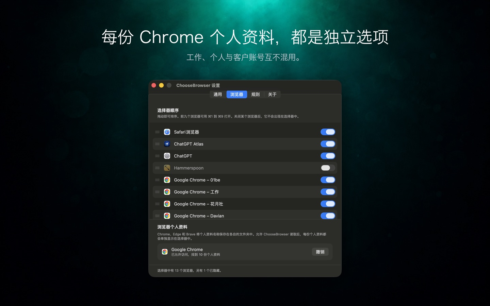

# chrome-use

[English](README.md) · **简体中文**

<p align="center">
  <a href="https://github.com/leeguooooo/chrome-use/releases"></a>
  <a href="https://github.com/leeguooooo/chrome-use/stargazers"></a>
  <a href="https://bot-detector.rebrowser.net/"></a>
  
  <a href="LICENSE"></a>
</p>

<p align="center"><i>⭐ 如果它帮你省掉了一次重新登录，点个 star 能让更多开发者找到它。</i></p>


<p align="center">
  
  <br>
  <sub>指向你<b>真实</b> Chrome 里的一个页面 → 一条命令拿到结构化数据。<a href="assets/demo.tape">（重新生成：<code>vhs assets/demo.tape</code>）</a></sub>
</p>

<p align="center">
  <a href="https://github.com/leeguooooo/chrome-use/releases/download/film-why-chrome-use/why-chrome-use-zh.mp4"></a>
  <br>
  <sub><b>5 分钟看懂为什么用 chrome-use：</b><a href="https://github.com/leeguooooo/chrome-use/releases/download/film-why-chrome-use/why-chrome-use-zh.mp4">中文（MP4）</a> · <a href="https://github.com/leeguooooo/chrome-use/releases/download/film-why-chrome-use/why-chrome-use-en.mp4">English (MP4)</a></sub>
</p>

**chrome-use** 让任意 AI agent 直接操作你自己正在用的、已登录的 Chrome。它复用你的登录态，保留现有浏览器配置；公开检测结果见下文，不代表所有网站都无法识别自动化。属于 `*-use` 家族（[iphone-use](https://github.com/leeguooooo/iphone-use) 驱动你的真实 iPhone，[bitwarden-use](https://github.com/leeguooooo/bitwarden-use) 从你的 Bitwarden 库里取密码、2FA 和 passkey，让 agent 用账号密码登录，chrome-use 驱动你的真实 Chrome）。

<sub>最初基于 [vercel-labs/agent-browser](https://github.com/vercel-labs/agent-browser)（Apache-2.0）；现已是独立项目。隐身/扩展中继架构、反检测、humanize、多 agent 隔离与 CLI 都已大幅分化。</sub>

> 📚 **文档站：** **[chrome-use.leeguoo.com](https://chrome-use.leeguoo.com)**：完整指南、工作流与命令参考（中文 · English）。
>
> 📖 **深入原理：** [让 agent 点进跨域 iframe：chrome-use 如何解决浏览器控制里最难的一环（English）](https://blog.leeguoo.com/en/posts/chrome-use-cross-origin-iframe/)
> · [让任何 AI Agent 直接驱动你已登录的真实 Chrome，CreepJS 给它打 0% bot](https://blog.leeguoo.com/zh/posts/chrome-use-drive-your-real-chrome/)

<table>
<tr><td align="center" width="960">

**广告位 · 招租中**

### 广告位招租

在这里展示你的产品，支持项目持续维护。

[**咨询广告合作**](mailto:leeguoooo@gmail.com?subject=chrome-use%20%E5%B9%BF%E5%91%8A%E5%90%88%E4%BD%9C&body=%E4%BA%A7%E5%93%81%20%2F%20%E5%85%AC%E5%8F%B8%E5%90%8D%E7%A7%B0%EF%BC%9A%0A%E4%BA%A7%E5%93%81%E9%93%BE%E6%8E%A5%EF%BC%9A%0A%E5%B8%8C%E6%9C%9B%E6%8A%95%E6%94%BE%E7%9A%84%E4%BD%8D%E7%BD%AE%EF%BC%88README%20%2F%20%E5%AE%98%E7%BD%91%20%2F%20%E4%B8%A4%E8%80%85%EF%BC%89%EF%BC%9A%0A%E6%8A%95%E6%94%BE%E6%97%B6%E9%97%B4%EF%BC%9A%0A%E9%A2%84%E7%AE%97%20%2F%20%E5%B8%81%E7%A7%8D%EF%BC%88%E5%8F%AF%E9%80%89%EF%BC%89%EF%BC%9A%0A) · leeguoooo@gmail.com

</td></tr>
</table>


## 付费接入与项目赞助

需要帮你把 agent 接到已登录的 Chrome，或跑通浏览器流程？ 发邮件说明设备环境、要跑通的流程和预期结果，以及目前卡在哪里。我们先评估可行性，再确认服务范围、验收方式和报价。

[**咨询付费接入**](mailto:leeguoooo@gmail.com?subject=chrome-use%20%E4%BB%98%E8%B4%B9%E6%8E%A5%E5%85%A5%E5%92%A8%E8%AF%A2&body=%E7%9B%AE%E6%A0%87%E7%BD%91%E7%AB%99%E6%88%96%20App%EF%BC%88%E4%BB%85%E5%85%AC%E5%BC%80%E4%BF%A1%E6%81%AF%EF%BC%89%EF%BC%9A%0A%E8%A6%81%E8%B7%91%E9%80%9A%E7%9A%84%E6%B5%81%E7%A8%8B%E5%92%8C%E9%A2%84%E6%9C%9F%E7%BB%93%E6%9E%9C%EF%BC%9A%0A%E7%8E%AF%E5%A2%83%EF%BC%88OS%20%2F%20browser%20%2F%20agent%20client%EF%BC%89%EF%BC%9A%0A%E7%9B%AE%E5%89%8D%E5%8D%A1%E5%9C%A8%E5%93%AA%E9%87%8C%EF%BC%9A%0A%E9%A2%84%E7%AE%97%20%2F%20%E5%B8%81%E7%A7%8D%EF%BC%88%E5%8F%AF%E9%80%89%EF%BC%89%EF%BC%9A%0A%E6%9C%9F%E6%9C%9B%E6%97%B6%E9%97%B4%EF%BC%9A%0A) · [联系赞助维护](mailto:leeguoooo@gmail.com?subject=chrome-use%20%E8%B5%9E%E5%8A%A9%E7%BB%B4%E6%8A%A4&body=%E6%88%91%E6%83%B3%E6%94%AF%E6%8C%81%E9%A1%B9%E7%9B%AE%E6%8C%81%E7%BB%AD%E7%BB%B4%E6%8A%A4%E3%80%82%0A%E8%B5%9E%E5%8A%A9%E6%96%B9%E5%BC%8F%EF%BC%88%E4%B8%80%E6%AC%A1%E6%80%A7%E6%88%96%E6%8C%89%E6%9C%88%EF%BC%89%EF%BC%9A%0A%E9%87%91%E9%A2%9D%20%2F%20%E5%B8%81%E7%A7%8D%EF%BC%9A%0A) · leeguoooo@gmail.com

想支持项目持续维护，也可以邮件联系，商量一次性或按月赞助。

普通问题和功能建议仍可在 GitHub 提交。咨询时请勿附上密码、验证码或私人账号数据。

## 把你**已经登录好**的浏览器，交给你的 AI agent

**不用开新 Chrome。不用重新登录。不用跟"你是不是机器人"较劲。**

chrome-use 让**任意** agent（Claude Code、Cursor、Codex、你自己的脚本）直接操作你**已经登录了所有网站**的那个 Chrome。它在**你的窗口里、以 ✦ 开头的标签组中**点击，你看着它干活，撞到 2FA / 验证码的瞬间你接管一下，它接着跑。因为它**就是你的真实浏览器**（一键装的扩展、原生消息、无调试端口），在公开 CreepJS 测试中：**[CreepJS 实测 0% 机器人](#反检测)。**

**新建浏览器上下文**没有现有登录态。Playwright / Puppeteer 也支持持久化配置或已有浏览器连接，需要比较实际配置。**chrome-use** 连接你**现有**的 Chrome：cookies、会话、浏览器指纹全是真的，因为它**就是**你的真实浏览器。Chrome 136 限制默认配置文件的远程调试；授权要求随 Chrome 版本和连接方式而变。我们的扩展改用原生消息：**装一次，之后零确认。**

| | 常规自动化（Playwright · Puppeteer · browser-use） | web-access / 裸 CDP 端口 | [Claude in Chrome](https://www.anthropic.com/claude/chrome) | **chrome-use** |
|---|:---:|:---:|:---:|:---:|
| **任意** agent / CLI 都能用（不绑单一 app） | ✅ | ✅ | ❌ 仅 Claude | ✅ |
| 驱动你**真实、已登录**的 Chrome | 可配置；新上下文默认无登录态 | ✅ | ✅ | ✅ |
| 连接方式 / **"Allow remote debugging?" 弹框** | —（自带浏览器） | `--remote-debugging-port` · 取决于版本和模式 | `chrome.debugger` · 无 | 原生消息 · **从不** ✅⁴ |
| 真实浏览器指纹（CreepJS ~0%）¹ | ❌ 自动化特征 / headless | ✅ | ✅ | ✅ **已实测 0%** |
| **无 `Runtime.enable` CDP 泄漏**（rebrowser）² | ❌ 泄漏 | ❌ 泄漏 | ✅ 实测无泄漏（2026-10-27） | ✅ **默认关闭** |
| 多 agent 共用**同一个**真实 Chrome、标签组隔离³ | ❌ 各开各的浏览器 | ⚠️ 共享 tab、无隔离 | ❌ 单 app | ✅ |
| 权限面 | 完全控制 | 完整 CDP | 16 个，含 `<all_urls>` | **15 个，不授予任何站点权限**（`http/https` 为可选） |

<sub>¹ 三家「真实 Chrome」工具在 CreepJS 上都 ~0%（毕竟是真浏览器），我们的是实测过的。² rebrowser `runtimeEnableLeak`：我们的中继路径实测无泄漏；Claude in Chrome 也实测无泄漏（2026-10-27，16 绿 0 红，见 [bench/claude-in-chrome](bench/claude-in-chrome/)）。³ web-access 也能跑并行子 agent，但无每会话隔离；本工具每个 `--session` 拿到自己彩色、命令隔离的标签组。⁴ 不弹同意框，但扩展仍然用 `chrome.debugger`，所以 agent 标签页被 attach 时 Chrome 会显示「started debugging this browser」提示条，去掉方法见 [连接你的 Chrome](#连接你的-chrome)。实测数字见 [反检测](#反检测)。</sub>

## 工作原理


你的 **chrome-use CLI** 通过 Chrome **原生消息（native messaging）** 和一个小**浏览器扩展**通信：这是本机进程间通道，**无网络端口、无 token、无远程服务器**。扩展用 `chrome.debugger` 驱动你指定的标签页（在你**已登录**的 Chrome 里），再把结果交还给 CLI。全程都在你本机。


每个 `--session` 拿到**自己的彩色标签组**，多个 agent 共用同一个真实浏览器、互不干扰，也不动你自己的标签页。省略 `--session` 时，chrome-use 会按支持的 runner id（包括 Codex 的 `CODEX_THREAD_ID`）派生稳定的 per-agent 会话；显式 `--session` / `AGENT_BROWSER_SESSION` 始终优先。会话命名、`session list` / `stop` / `prune`、所有权交接与 daemon 恢复见[会话指南](https://chrome-use.leeguoo.com/sessions.html)。

## 安装

**macOS / Linux**

```bash
curl -fsSL https://raw.githubusercontent.com/leeguooooo/chrome-use/main/install.sh | sh
```

**Windows**（PowerShell）

```powershell
irm https://raw.githubusercontent.com/leeguooooo/chrome-use/main/install.ps1 | iex
```

从最新的 [GitHub Release](https://github.com/leeguooooo/chrome-use/releases) 下载对应平台的预编译二进制，安装 `chrome-use`。无需 npm，无需 token。

<details>
<summary>其他安装方式</summary>

- **锁定版本：** `curl -fsSL https://raw.githubusercontent.com/leeguooooo/chrome-use/main/install.sh | AGENT_BROWSER_VERSION=v1.5.188 sh`
- **自定义路径：** `curl -fsSL … | AGENT_BROWSER_BIN_DIR=$HOME/bin sh`
- **macOS 应用包：** 在 Mac 上，安装脚本把签名并公证过的 `ChromeUse.app` 放到 bin 目录旁边的 `<prefix>/share/chrome-use/`（默认 `~/.local/share/chrome-use/`），`chrome-use` 是指向它的软链接。侧栏里的 agent 在「文稿」「桌面」「下载」下的项目里干活时，系统设置 → 隐私与安全性 →「文件与文件夹」里只会出现一条带图标的「ChromeUse」。想装裸二进制就设 `AGENT_BROWSER_NO_APP_BUNDLE=1`。
- **Windows 锁定版本或安装位置：** 在 `irm … | iex` 前先设置 `$env:AGENT_BROWSER_VERSION = 'v1.5.139'` 或 `$env:AGENT_BROWSER_BIN_DIR = 'D:\tools'`。默认装到 `%LOCALAPPDATA%\Programs\chrome-use` 并加入用户 PATH，原有条目原样保留（不想改 PATH 就设 `$env:AGENT_BROWSER_NO_PATH = 1`）。不需要管理员权限。
- **Windows 手动安装：** 从 [Releases 页](https://github.com/leeguooooo/chrome-use/releases) 下载 `chrome-use-win32-x64.tar.gz` 和对应的 `.sha256`，确认 `(Get-FileHash chrome-use-win32-x64.tar.gz -Algorithm SHA256).Hash` 与 `.sha256` 文件一致，用 `tar -xzf chrome-use-win32-x64.tar.gz` 解压，再把 `chrome-use.exe` 放进 PATH。运行前一定先对哈希：下载中断的包照样能解压出 `.exe`，它会在启动时报访问违规（退出码 `-1073741819`，即 `0xC0000005`），而不会提示下载不完整。
</details>

### 用 Nix 安装

免安装直接运行一次：`nix run github:leeguooooo/chrome-use -- --help`。
flake 同时提供 home-manager 模块和 NixOS 模块（`programs.chrome-use.enable = true`）；NixOS 上原生消息 host 是按用户注册的，切换后运行一次 `chrome-use extension connect`（它会像 `extension install` 一样注册 host，然后连上扩展中继）。
开发环境：`nix develop`（rust 工具链 + node 24 + pnpm + chromium + vhs）。
完整片段见[安装指南](https://chrome-use.leeguoo.com/install.html)。

### 安装 AI agent skill

使用新版 CLI 时，安装脚本直接安装并校验内置的发现入口，不需要 Node、npx、Git 或额外下载。手动安装或刷新：

```bash
chrome-use skills install
chrome-use skills install --project
```

全局安装覆盖 `~/.agents/skills`、Claude Code、Codex 和 Cursor，以及检测到配置目录的 Pi、OpenCode、Windsurf、CodeBuddy 和 Trae；遵循 `CLAUDE_CONFIG_DIR`、`XDG_CONFIG_HOME`。项目安装写入 `.agents/skills`、`.claude/skills`，以及已有的 `.pi`、`.windsurf`、`.codebuddy`、`.trae` 配置目录。安装后重启 agent 或重新加载技能。任一目录写入失败都会报错，即使其他目录已成功。详见[安装说明](https://chrome-use.leeguoo.com/install.html)。

**Claude Code，插件市场（推荐）：** 全局安装 skill（所有项目可见）、自动更新，并列出 [`*-use` 家族](https://github.com/leeguooooo/plugins)的其他成员：

```
/plugin marketplace add leeguooooo/plugins
/plugin install chrome-use@leeguooooo-plugins
```

**更多 runner：** 内置目录映射之外的 runner 仍可通过 [skills.sh](https://skills.sh) 安装；这条可选路径需要 Node 及其自身依赖：

```bash
npx skills add leeguooooo/chrome-use -g
```

> 上面的一行安装命令已安装内置技能，可用 `AGENT_BROWSER_NO_SKILL=1` 跳过。PowerShell 安装脚本也能从固定的旧版 CLI 提取技能，绕过旧版的 npx 安装逻辑。安装错误会中止完成提示；脚本完成不代表 Chrome 扩展已经连通。

> **Codex 用户注意：** Codex 自带浏览器插件，遇到浏览器任务会优先选它。在一台装了很多 skill 的机器上实测，Codex 还会把每个 skill 的描述截到只剩几个字符（甚至没有），所以 skill 描述赢不了路由，在 prompt 里点名 `chrome-use` 也不够。有效的做法是在项目的 `AGENTS.md` 里加一行：
>
> ```
> Use the `chrome-use` CLI from the shell for every browser task; start with `chrome-use skills get core`. Do not use the built-in Chrome plugin for browser work here.
> ```

无论哪种方式，agent 都会拿到正确的用法和 `chrome-use` 的预授权 bash 权限；二进制缺失时 skill 会自动重跑上面对应平台的一行安装命令来修复。专项指南（`electron`、`slack`、`agentcore` 等）由二进制自己通过 `chrome-use skills get <name>` 提供，所以说明永远和已安装版本一致。

升级二进制**不会**更新已经拷到 runner 里的 SKILL.md；那份副本在二进制之外。`chrome-use upgrade` 两样都管：先装最新的 GitHub Release，再逐个刷新找到的 skill 副本（Claude Code 插件、git checkout、安装脚本写入的目录；`npx skills add` 拷的副本会提示运行 `npx skills update chrome-use`）。`chrome-use upgrade --check`（或 `--json`）什么都不改，只报告当前版本、最新版本和 skill 装在哪；退出码 2 表示检查失败。其他命令，以及 Chrome 每次启动本机连接时，每天最多在后台检查一次；有新版本就在后台原地安装（下次运行生效），并刷新 skill 副本。设 `CHROME_USE_AUTO_UPGRADE=0` 可关掉自动安装，改为每次在 stderr 打一行提示；设 `CHROME_USE_NO_UPDATE_CHECK=1` 或全家通用的 `USE_NO_UPDATE_CHECK=1` 连检查一起关掉。装在没有写权限的位置（包管理器的路径）时不会替换，只提示要运行的命令。扩展的弹窗和侧边栏也会显示 CLI 是否过旧，带"更新 CLI"按钮，扩展自己有更新待装时同样会提示。只刷新 skill 用 `chrome-use skills update`（`refresh` / `install` 是同一个命令；加 `--project` 装到 `./` 而不是全局）。

### 从 MCP 客户端使用（Claude Desktop 等）

对于**支持 MCP 但不能执行任意 shell 命令**的宿主（Claude Desktop、ChatGPT connectors、n8n/Dify），把 chrome-use 作为 MCP stdio server 写进 Claude Desktop 的 `claude_desktop_config.json`：

```json
{
  "mcpServers": {
    "chrome-use": { "command": "chrome-use", "args": ["mcp"] }
  }
}
```

### 本机 agent 侧栏

完整使用说明：[插件对话](https://chrome-use.leeguoo.com/agent-panel.html)。

<p align="center">
  
</p>

点击扩展图标打开侧栏，**Settings** 打开连接设置。macOS、Linux 和 Windows 可选择 **Codex**、**Claude Code**、**OpenCode** 或 **Pi**，沿用已安装 CLI 的登录和模型服务配置。菜单只列出当前主机支持的 agent；旧主机需升级才能使用新增适配器。Windows 同样支持聊天、配置预览/应用/恢复、技能、图片、会话参数和定时任务。旧 Windows 主机需升级 CLI，不需要管理员权限。agent 进程通过独立 Windows Job 管理，面板私有文件仅允许当前用户和 SYSTEM 访问。

Codex 走 app-server 协议，Claude Code 走 stream-json，OpenCode 走 ACP，Pi 走 JSONL RPC。每个会话使用独立浏览器 session。输入框上方的页面标签会随下一条消息附带当前网页，让 agent 知道要操作哪个标签页；点 **×** 可从这条消息中去掉它。

模型下拉来自所选 CLI 的目录。**Default model** 沿用 CLI 配置的模型；在 **＋** 菜单填写 **Custom model ID** 可覆盖下拉选择，**Reload models from CLI** 重新读取目录。版本、账号状态和模型目录不证明实际调用可用。**Agents & models** 可发现程序、预览配置改动、写入读回及恢复，恢复时保留后来的修改。保存默认模型不会改变已经运行的会话。

权限开关只作用于当前会话。新会话默认开启 **Full access**，除非你保存过其他选择：

- **Codex / Claude Code**：关闭后显示 **Ask first**，由你处理审批请求。完整权限模式不再逐次询问，并自动回复支持的审批；agent 提问仍需你回答。
- **OpenCode**：关闭后显示 **CLI permissions**，遵循 OpenCode 自己的规则，部分工具可能无需询问。收到的审批会显示在侧栏，完整权限模式按 **Allow once** 自动回复，不改它保存的权限规则。
- **Pi**：没有逐次审批机制。关闭后显示 **Browser only**，只开放 `chrome_use` MCP 工具，不开放 shell 或文件工具；开启后使用 CLI 的完整工具集。

历史显示流式回复、可展开的工具行和请求。工具返回不代表浏览器任务成功。回复中发送的消息进入队列，开始前可编辑或删除；长预览先点 **Load full text**。失败或中断后队列暂停，点 **Resume queue** 恢复。 失败或中断后，新发的消息会在原会话中使用原模型立即开始；旧队列仍暂停，需手动恢复。**Stop & send** 或 Ctrl/Cmd+Enter 等收到终止确认或确认进程退出后才优先发送，普通队列仍暂停。重连只读回历史，不重发。发送结果未确认时，可明确选择按原消息 ID 重试；清除提示不会取消可能已送达的任务。

面板回复会原样显示围栏代码块。示例内含三个反引号时，请在外层使用更长的围栏。结束围栏须使用相同字符，长度不得短于起始围栏，后面只能有空白。

删除会话前先停止回复，再点顶部删除按钮并确认。删除内容包括面板历史和该会话的浏览器 session，以及 Codex rollout 文件、Claude 会话文件及目录、通过 `session/delete` 删除的 OpenCode 历史，或会话文件夹内的 Pi 会话文件。Codex 的 SQLite 缓存不改动。清理失败或标签页关闭未确认时，侧栏会提示。

会话菜单每行提供“初始网页”“最终网页”和“删除会话”。初始网页打开首次记录的 HTTP(S) 网址；最终网页打开最近记录的网址，任务运行中也按最近记录为准。已记录的标签页网址一致时直接定位，否则在新标签页打开。打开初始网页不会覆盖最终地址。旧会话没有初始地址时会明确提示。点击标题切换聊天；打开网页不会发消息、重跑任务或恢复未保存的输入。地址仅保存在本机扩展存储中。删除需确认，清理失败会提示；回复中需先停止再删除。

在 /resume 选择器中，更换 agent 或修改搜索内容会立即清除旧选项。Enter 只选择当前列表中的会话；加载中、列表不可用或结果为空时不会打开或继续会话。更换 agent、修改搜索或关闭选择器也会清除旧确认框，旧的继续请求返回后不会打开之前的会话；已发给主机的请求仍可能完成，等待期间可以选择新的结果。

`/resume` 可以接着用你在终端里开始的 Claude Code、Codex、OpenCode 或 Pi 会话；新会话也可以在项目文件夹中工作，网站可以记住它的项目。详见[继续终端里的会话](https://chrome-use.leeguoo.com/agent-panel.html#resume)和[项目文件夹](https://chrome-use.leeguoo.com/agent-panel.html#project)。

Chrome 替换已记录的初始网页标签页时，会话会跟随替换后的标签页，不会重复打开。已保存的初始网址和最终网址仍分别保留。

面板历史按 Chrome profile 保存在本机 `~/.chrome-use/agent-panel`。所选 CLI 可能把任务和网页内容发送给它配置的模型服务，该服务的隐私政策适用。侧栏没有新增网页 content script，打开时仍可能改变页面视口。下面的点选改代码只在你按快捷键或按钮时才注入页面。自定义程序需填写绝对路径。

点击任务通知会激活对应会话的标签页，并聚焦该标签页所在的窗口，即使之前使用的是另一个 Chrome 窗口，或当前窗口尚未确定。已绑定的会话标签优先于最后聚焦的窗口。

侧栏还支持以下功能：

- **技能：**输入 `/` 选择内置技能、用户技能或当前 Chrome profile 的技能库条目。在 **Agents & models → Skill library** 编辑、启停库内技能，或从本机绝对路径目录、ZIP/.skill 压缩包、HTTPS Git 仓库导入。用户和 CLI 原有技能目录在这里只读。发送前会保存所选技能及文件的副本，排队和明确重试使用同一份内容。面板中的 agent 可通过 `chrome_use_skills` 列出、读取技能或当前所选技能的相对路径文本文件，并在用户要求时保存库内说明。
- **图片：**用 **Attach images** 选择图片，也可粘贴或拖入，每条消息最多五张 PNG/JPEG/WebP/HEIC。Chrome 无法解码 HEIC，由本地 CLI 用系统编解码器转成 JPEG（macOS 用 `sips`；Windows 需要从 Microsoft Store 安装 HEIF 图像扩展和 HEVC 视频扩展；Linux 需要 `heif-convert` 或带 HEIF 支持的 ImageMagick），按照片方向转正，并去掉包括 GPS 在内的 EXIF 信息。传输前缩到最长边 2000 像素，每张不超过 512 KiB。图片随会话保存，队列编辑和重试会保留，删除会话时一起清理。ACP agent 必须声明支持图片输入，不支持时会报错，不会丢掉图片只发送文字。附件会交给所选模型服务。
- **会话参数：**选择允许的工具，Codex/Claude 可另设推理强度，Codex 可设服务等级。空闲时保存，下一次回复生效，不改 CLI 全局配置。Codex 能限制写入，但无法移除可以读文件的 shell；OpenCode ACP 无法保证限制内置工具，仍遵循它自己的权限规则。审批开关只决定是否自动处理当前工具范围内的请求，Pi 没有逐次审批。
- **定时提示：**在 **Agents & models → Scheduled prompts** 设置间隔、每天或工作日的本地时间、五字段 cron，并保存 agent、模型、会话参数、技能和明确的工具范围。**Run now** 不改变下一次到期时间。任务使用独立后台浏览器 session，结果保留在历史，完成通知可打开对应会话。主机上的本地服务需要运行，关闭侧栏不会停掉服务。重启或唤醒后，错过的周期只补跑一次；上次仍在执行或结果未确认时，不会重叠执行或重放。确认未知结果前先看历史。聊天不能创建比自己工具范围更大或审批权限更高的任务；定时聊天不能修改或触发定时任务，也不能重写供未来任务使用的技能库。消息已接收、agent 已结束和网页目标已达成仍需分别确认。
- **完成通知：**侧栏任务完成、失败、被停止、需要恢复或等待你批准时，Chrome 会弹出通知（结果加上脱敏后回答的第一行），工具栏图标显示未看的数量。点通知会在侧栏打开对应会话。侧栏已在当前窗口显示的会话不会通知。可在 **Settings → Notify when a task finishes** 关闭。定时任务仍用它自己的完成通知。

Chrome 拒绝显示侧栏任务通知时，同一次扩展后台运行期间的后续检查会重试。已关闭的通知和正在查看的任务仍不会弹出通知。通知创建期间查看过的任务，即使创建随后失败，也不会在后续检查或扩展后台重启后重复通知。

### 点选改代码（Inspect & Ask）

按 **Alt+Shift+C**（或工具栏弹窗里的 **Inspect element**），点一个元素，写一句要改成什么样，回车。chrome-use 会把这句话、元素的源码 `文件:行号`、裁好的截图和样式，通过 [ocs](https://github.com/leeguooooo/open-cross-session) 交给已经在这个项目里运行的 Claude Code、Codex 或 Pi 会话。本地 dev server 和测试环境域名都能用，用的是你已登录的 Chrome。

- **源码位置**来自 [code-inspector-plugin](https://github.com/zh-lx/code-inspector) 注入的 `data-insp-path`（Vite、webpack、Rspack、esbuild、Turbopack；React、Vue 等）。React 18 和 Vue 的开发构建不接插件也能读到；都读不到时消息会标明“没有源码位置”，并附上选择器和文本。页面没有标记时，面板会列出要改的地方，征得你同意后再让 agent 接入插件。测试构建需要显式打开，生产构建永远不开。
- **多选与标注**：Shift+点击或拖框最多选 8 个，↑/↓ 切换父子元素，P 暂停动画，每个元素可写备注，截图上可以画笔标注。**Copy** 不经过 ocs，直接复制成 Markdown；**Open in editor** 用 VS Code、Cursor、Windsurf 或 WebStorm 打开对应文件。
- **项目和会话**：每个站点（或路径）一张确认卡，只有本地证据才会预选：仓库里提交的 `.chrome-use/inspect.json` 写明了站点域名（支持一层子域名通配），或本地 dev server 的进程目录，并且这个项目里正好只有一个会话。也可以在会话里执行 `chrome-use inspect link <网址>` 认领；站点已属于别的会话时，要等你在面板里确认。临时换目标用 **Only this tab**。不同 worktree 严格区分，页面数据只参与排序。
- **投递不会重放**：每批请求有自己的 ID，ocs 的“已存储”和“已唤醒”分开显示，结果不明时只查询、不重发。完整上下文写在 `~/.chrome-use/inspect/ctx/<id>/`，只有你能读，7 天后清理；之后只留下批次 ID 和结果的记录，保证同一批不会发两次。
- **边界**：默认关闭；不常驻页面，也不出现调试提示条。输入框运行在扩展自己的 iframe 里，凭一次性密钥认证，页面脚本读不到也改不了你写的内容；每次发送前都重新确认输入框完整可见。页面内容标注为不可信数据，投递不会提高接收会话的权限。

详见 [点选改代码文档](https://chrome-use.leeguoo.com/inspect.html)。

### 示范录制：做一遍，之后不用模型就能重放

```bash
chrome-use open https://shop.example/cart && chrome-use teach start --name checkout
# ……在这个标签页里亲手做一遍……
chrome-use teach stop                       # 写到 ~/.chrome-use/teach/checkout.json，并列出步骤供检查
chrome-use teach replay ~/.chrome-use/teach/checkout.json --arg-env password=SHOP_PW
```

`teach stop` 生成 `chrome-use script` 步骤列表：优先用语义定位，CSS 选择器作为 `or` 备选，连续按键合成一次 fill，换页后自动等待，最后检查结束的网址。加 `--adapter` 则生成站点适配器骨架（`args.ui` 输入，配合 `--until-done`）。密码、卡号、一次性验证码不会被记录，变成 `--arg-env` 参数。侧边栏的**录制**按钮对当前标签页做同样的事，保存前先列出步骤。录制器运行在隔离环境里，只有那个环境有回传用的绑定，页面看不到任何东西，隐身模式下也一样。详见[示范录制](https://chrome-use.leeguoo.com/teach.html)。

## 连接你的 Chrome

从 Chrome 应用商店安装 [**chrome-use** 扩展](https://chromewebstore.google.com/detail/chrome-use/knfcmbamhjmaonkfnjhldjedeobeafmk)，再注册一次本地桥：

```bash
chrome-use extension install      # 注册原生消息 host（一次性）
chrome-use open https://x.com/home
chrome-use status                 # 中继、profile、扩展与会话健康总览
```

在 macOS/Linux 上，`chrome-use extension install` 还会为正在运行、以 `--user-data-dir=<path>` 单独启动的 Chromium 系浏览器注册本地 host，扫描到的自定义目录必须已经存在。如果浏览器尚未运行或无法被扫描到，可执行 `chrome-use extension install --user-data-dir "/path/Chrome Data"`；也接受 `--user-data-dir=<path>`，可重复指定多个目录。显式指定的目录不存在时会报错。命令会列出写入的清单，并回读校验 host 名称和启动器路径。这只确认注册完成；之后请在该 Chrome 里重新打开侧栏，或等扩展自动重连。Windows 使用 HKCU 注册表注册，不支持此选项。 自动扫描仅限当前用户的进程；发现目录写入或校验失败时警告并跳过，可用 `--user-data-dir` 重试，默认或显式目录失败仍报错。成功写入的自定义数据目录记录在 `~/.chrome-use/custom-host-dirs.json`，供状态查询和浏览器停止后的卸载清理使用；记录失败会警告卸载可能残留清单。

之后 `chrome-use open` 就通过**原生消息**驱动你真实、已登录的 Chrome：无调试端口、无 token、**永远不弹 "Allow remote debugging?"**。裸 remote-debugging 端口的备选方案（会弹同意框）见[真实 Chrome 指南](https://chrome-use.leeguoo.com/real-chrome.html)。

在 macOS/Linux 上，生成的 native-host 启动器会固定安装时的 `HOME` 和可选的绝对路径
`CHROME_USE_RELAY_DIR`，避免 Chrome 启动它时切换到别的环境。安装时未指定中继目录，
启动器会清除从 Chrome 继承的目录覆盖。已有启动器需要在目标环境下重跑 `extension install`
才会更新；隔离测试安装还应加 `--no-open --no-profile`，并设置 `CHROME_USE_NO_BROWSER_SCAN=1`。

`browsers --who <域名>` 只检查磁盘上的 Cookie 名称，不读取值；存在 Cookie 不代表会话仍有效。
macOS 先使用 PATH 中的 `sqlite3`，只有工具缺失或可执行格式不支持、无法启动时，才回退到
`/usr/bin/sqlite3`。执行权限拒绝，以及 SQLite 已启动后返回的查询错误，仍会明确报错；
数据库锁定或损坏不会通过换一个工具重试。

`extension install` 是一次性的安装步骤。`chrome-use extension connect`（别名 `chrome-use reconnect`）在扩展已装好的前提下重新连上它的中继，不重装任何东西。被 attach 的 agent 标签页上 Chrome 仍会显示「chrome-use started debugging this browser」提示条；`chrome-use extension connect --silent` 会带 `--silent-debugger-extension-api` 把 Chrome 重启一次来去掉它（标签和登录自动恢复；同时开着多个 Chrome 实例时不会重启）。`--keep-banner` 完全不碰浏览器；两个 flag 都不带时，交互终端里会先问一句。详见[静音提示条](https://chrome-use.leeguoo.com/debugger-banner-silence.html)。

AI 标签默认开在你正在用的窗口里，以后台标签打开、不抢焦点；每个会话有自己的标签组，组名前面带 ✦，一眼能和你自己的标签分开。加 `--window dedicated` 则改为同一 Chrome profile 的所有 AI 会话共用一个后台专用窗口：已有窗口只要标签归属都能确认是 AI，就会复用，全屏也不另开窗口。归属不明或空白占位页清理失败时会报错，避免继续增加窗口。不会为回收窗口而搬走或删除用户页。你在 AI 窗口里开了或拖进了自己的页面，这个窗口就归你：里面已有的 AI 标签照常工作，新的 AI 标签开到一个新的 AI 窗口，之后的会话共用它。

浏览器命令通常要求所选 Chrome profile 已有打开的窗口。如果 Chrome 正在运行、relay 未连接，且 Local State 未把该 profile 列为 active，恢复流程会先等同一个 profile 持续未列出满 20 秒，给刚打开的窗口或 relay 留出启动时间；状态变为 active 或无法判断时，会取消待发出的开窗请求。之后最多请求打开一个 profile 窗口，并在请求后 20 秒再次检查，总等待仍不超过原有的 45 秒。打开窗口不代表 relay 已连接。这项恢复在 macOS 上可能短暂把 Chrome 提到前台；焦点恢复只是尽力而为，不保证回到原来的另一个 Chrome 窗口。这个例外仅限 profile 恢复，普通标签页操作仍留在后台。`status` 只读元数据，不会打开窗口。`AGENT_BROWSER_NO_AUTO_RECONNECT` 可关闭自动恢复。元数据缺失或格式错误时不会请求开窗。进程参数有歧义时，仍按用户浏览器正在运行处理；只有能明确识别为其他数据目录下的自动化实例才会排除。恢复后仍未连接时，按错误中给出的 profile 或 relay 状态处理，不要只因 relay 断开就重启 Chrome。

中继超时仅表示命令未在期限内完成。标签元数据无法证明 JavaScript 阻塞或命令通道正常。
截图仍在等待时，JavaScript 也可能正常回答。保留标签，检查 `status` 和 `tab inspect <ref>`，
避免重叠重试截图，并在重复执行操作前确认它是否已经生效。探针失败时也应先查看原因，不要直接认定标签已关闭。

### 多 profile 的 Chrome：读 ChooseBrowser 的规则

同时开着工作号、个人号、客户号的人，心里本来就清楚「哪个站点用哪个账号」，只是每次都要用 `--browser` 再告诉我们一遍。[ChooseBrowser](https://choosebrowser.leeguoo.com) 是一个 macOS 链接路由工具，它把这份映射存了下来。装了它之后，`chrome-use open <url>` 在你没显式指定 `--browser` 时会按你自己写的规则选 profile，并且会说明来源：

```
$ chrome-use open https://github.com/my-org/repo
· using Chrome profile Profile 14 — a ChooseBrowser rule routes this site there
  (github.com|/my-org*). Override with --browser <id|email>, or skip with
  --no-choosebrowser.
```

只读，没装的话完全无感：没有规则文件就不改变任何行为、也不打任何提示。规则是硬约束：chrome-use 不会把这个站点开到别的 profile 里。规则指向的 profile 没连上时，命令直接失败，并给出 `chrome-use connect --browser <profile>`；当前 session 已经绑定在另一个 profile 上时，命令同样失败，提示换一个新的 `--session` 或加 `--no-choosebrowser`。显式 `--browser` 和配置文件里的路由仍然优先。这条检查同样覆盖 `batch` 的每一步、MCP 工具调用和 script 步骤。规则指向的 profile 在本机已不存在时只给警告，不拦截。`chrome-use doctor` 会逐条列出规则，以及它指向的 profile 现在是否已连接。在显式 `--browser` 后面加 `--remember`，chrome-use 会请 ChooseBrowser 把规则写回去，由它自己的确认弹窗把关。

<a href="https://choosebrowser.leeguoo.com"></a>

**ChooseBrowser** 是 chrome-use 作者做的 macOS 链接路由器。设为默认浏览器之后，你点的每个链接都会先问一句：开在哪个浏览器、哪个 Chrome profile。

- Chrome、Edge、Brave、Vivaldi、Chromium 的每个 profile 都是独立的一行，工作、个人、客户账号各走各的。
- 规则可以匹配路径，不只看域名，同一个网站可以有两个去向。
- `⌘1`–`⌘9` 直接打开，`⌥↵` 记住一次，它还会学你在每个网站的偏好。
- 无账号、无跟踪、无统计。多台 Mac 同步走你自己的 iCloud，可选。

免费试用 7 天，之后 **US$4.99 一次性买断，最多 3 台 Mac**。公证过的 `.dmg`，需要 macOS 26 或更高。[下载](https://choosebrowser.leeguoo.com) · [完整介绍](https://chrome-use.leeguoo.com/choosebrowser.html)。chrome-use 不依赖它。

<br clear="all">

已安装的发现入口应引导 agent 执行 `chrome-use skills get core`，不应另带一套命令手册。若旧副本只有自己的操作说明而没有这一步，应先用 `chrome-use skills update` 刷新入口，再比较 core 指南的变化。

## 用法

如果能从 Monaco 模块中找到与目标编辑器对应的 API，`fill` 会使用原生输入并验证同一个实时 model（`engine: monaco-native`）；`get value` 也会直接读取该 model，不执行复制或粘贴。这条路径不使用系统剪贴板。Monaco 0.52 压缩 AMD 加载器在全局 API 被移除后保留的已完成模块导出，也可使用这条路径。发现过程只在限定范围内读取模块表，不调用加载器、模块工厂或访问器，不加载模块，也不发起请求。插入前必须验证原生全选已覆盖整个实时 model。model 被替换、焦点丢失、选区不完整或回读不匹配时会报错，输入后不会再通过剪贴板重试。无法找到精确对应的 model API 时，`fill` 和 `get value` 默认在访问剪贴板前拒绝操作。只有用户接受临时改变系统剪贴板后，才在这一次命令中加 `--allow-clipboard-fallback`。该选项仅支持这两个命令，不会持久保存，也不会在原生输入或 model 验证失败后启用回退。实际使用回退时会警告：比较与恢复不是原子操作，可能覆盖同时写入剪贴板的新内容。Monaco 剪贴板回退将事务状态保存在私有闭包中；操作结束、初始化失败或文档仍存活时的 60 秒租约到期都会移除临时监听器。备份使用独立 Blob 构造的剪贴板项，因为浏览器返回的 ClipboardItem 可能在写入后失效。备份为空或不可读时，在暂存前拒绝操作。继续输入和恢复前都会比较内容；内容改变或归属不确定时停止操作。恢复后读取验证结果。仅能备份 Web Clipboard API 暴露的格式，无法保留应用原生元数据。即使编辑器已改变，恢复失败仍报错。执行上下文丢失可能阻止恢复，比较与写入也不是原子操作；请避免同时使用剪贴板。

该选项应放在必填文本或选择器之后，作为最后一个选项；`--` 结束编辑器选项解析，必填文本本身等于这个选项名时仍按原文填写。剪贴板的动作策略和确认要求仍然生效。批准不会越过拒绝规则，扩展持有的站点请求仍需用户在扩展中作出决定。 文档、输入和剪贴板操作的批准绑定原有会话持有的目标及新核实的 HTTP(S) renderer securityOrigin；来源缺失或不透明时拒绝。显式 HTTP(S) 导航绑定原目标（若有）及不可变目的地址，可从 about:blank 或冷启动获批。 既有 `tab new` API 支持 HTTP(S) 或默认 about:blank，`window new` 仍只创建其已声明的 about:blank 目标。这两个创建命令绑定动作和目的地址，批准后创建新的会话目标。window 的非空白地址会被拒绝；打开地址请用 `tab new <https-url>`。原来没有持有目标，或带 `--new-tab` 时，始终创建新的会话目标，保留审批期间出现的页面。导航指定目标时，先用 `chrome-use tab <target>` 选中它；显式目标与实际活动目标不一致时拒绝批准。JavaScript URL 和页内 SPA 操作仍需核实文档来源。`read <http(s) URL>` 绑定原地址和参数，不受浏览器出现或消失影响。 显式 HTTP 读取地址不触发标签页路由或强制接管；没有地址的 read 仍按当前文档核实批准。 HTTP 资源使用 `read` 分类，没有浏览器时也会检查文件中的站点域规则。字段策略检查使用目标自己的引用和 iframe 会话；上下文缺失或不可读时，在输入前拒绝。

跨站导航或重新连接后，页面读取使用当前文档。重建私有读取环境时，如果页面持续跳转，命令会明确失败；请重新观察页面再操作。

`chrome-use mobile serve --bind IP:17345` 在指定 IP 不可用时按 1–60 秒指数退避等待，保持原监听地址，监听成功后才报告就绪。换网后需更新 `--bind` 和手机连接地址，不会自动改为监听所有网卡。其他监听错误仍立即报错。

自定义下拉框会先即时滚入视口，再用真实指针事件打开。`pick` 未确认选中时返回 `verified: false` 和警告。页面及容器滚动使用即时移动，避免 CSS 平滑滚动在后台标签页停滞；位置未变化时返回 `scrolled: false` 和警告。

等待条件超时本身不能判断浏览器是否断线。`wait --text` 按区分大小写的子串匹配，需使用页面实际文案；所需回执已经出现时，不要重复等待。

`chrome-use skills get core` 包含日常操作循环和普通表单命令。按任务需要加载 `core/reading`、`core/connection` 或 `core/site-adapters`；普通点击不必另读 reference。每次只读取能回答下一步问题的状态，页面给出足以确认目标的信号后就停止验证。

核心循环：打开、读取、操作、只重读变化的部分。

```bash
chrome-use open https://example.com    # 连接你的 Chrome 并导航
chrome-use snapshot -i                 # 每次交互的起点：带 @ref 的可交互元素
chrome-use click @e3 --observe         # 操作，并观察页面的反应
chrome-use snapshot -i --diff          # 只回传相对上一张快照变化的部分
```

限定范围、深度、正则筛选或字节预算的快照，JSON `refs` 只返回正文摘录中出现的引用。会话仍保留完整的实时 ref 映射，缩小输出不会让先前已捕获的 ref 失效；稀疏页面检测仍使用完整映射。 有效增量快照的 JSON `refs` 只包含增量片段中的节点；无变化时为空。会话仍保留完整实时映射和先前引用；回退完整树时保持普通完整快照的行为。

交互快照只给角色和名称重复、且父级命名行无法区分的控件添加 `context`。上下文去掉控件自身名称和纯标点，最多约 100 个字符（无名称控件约 60 个），且不同控件的上下文必须不同。名称唯一的控件不带上下文；缺少商品价格等信息时，读取对应区域或完整快照。

滚动进度驱动的动画不会占用计时等待。普通有限时长动画仍会等待，DOM 变更和请求检查照旧。

用 `snapshot -i -c` 精简控件视图，已知区域用 scoped read；只有上一次观察还留下问题时才用 `--diff`。已知动作序列用 `batch`（每一步可以带自己的 `--observe`：`batch "fill @e1 Ada" "click @e2 --observe"`；`pick`、`hover` 和 `click` 一样可以观察），有条件分支的 observe/decide/act/verify 流程用 `script`，多个字段用 `form fill --map`，最后核验任务要求的结果：`observed.status: complete` 只表示这次捕获完整，不表示任务完成，要等页面自己的最终信号（`wait --text`）。小页面（树不超过 4 KB 且不超过 60 行）的观察直接带整棵当前树 `observed.snapshot` 和只含 `+`/`-` 行的 `observed.changes`；更大的页面照旧给 `delta`。`observed.text` 列出任意帧里变化的可见文字行（回执、日志、页码），不含输入框、文本域、下拉框和可编辑区域的内容，任一密码框带值时一行都不返回（`textStatus: redacted`）；读不到的帧列在 `textFrames` 里，观察随之变成 `partial`。每个 JSON 回复都带 `observed.target`，写明标签页和 target。`observed.announced` 收录动作执行和页面稳定期间出现的 toast 以及 alert/status/aria-live 区域的文字，回复前已经消失的也在（例如“视频审核中，修改未保存”）。元素截图写成 `screenshot <selector> <path>` 或 `screenshot <path> --selector <selector>`。只有树无法回答视觉问题时才加 `--with-screenshot <path>`。

可编辑区域（contenteditable）的 `fill` 在真实输入成功后保留编辑器焦点，不再派发合成的 `change` 或 `focusout` 事件。读回核验失败时会明确报错，不会覆盖编辑器 DOM。需要保存或确认时，请使用页面提供的操作。

`dblclick` 使用两次真实指针点击，并核验目标收到双击事件。目标被遮挡、禁用，或 frame 存在变换、跨源坐标无法可靠映射时会拒绝，不使用合成事件回退。第一次点击后目标变化时停止第二次点击。JSON 包含 `dispatch: "pointer"` 和 `verified`，无法确认事件送达时附带警告。操作中断或结果未确认时，请先检查页面再重试。双击不支持 `AGENT_BROWSER_CLICK_MODE=dom`。

`screenshot --annotate` 在 CLI 中把编号绘制到截图上，不会向页面插入节点或样式。JSON 标注框仍使用相对截图区域的 CSS 像素，图中的编号按图片分辨率缩放。显式裁剪区域优先于全页和元素截图。 框架引用使用所属渲染进程和顶层视口坐标。嵌套跨进程 iframe 通过协议四边形和隔离世界中的视口尺寸测量支持旋转、倾斜、镜像和透视变换，视口尺寸包含滚动条占用的空间，标注框包围投影后的四个角点。变换退化、数值不稳定、跨越透视无穷远线或框架几何信息缺失时会明确报错，不会猜测标注位置。 裁剪也在 CLI 中完成，视口外区域从全页截图中裁出。超出页面范围的区域会被拒绝。

普通元素截图和 `--clip` 区域截图也在 CLI 中裁剪像素，页面滚动后仍按文档坐标取图。视口内区域从现有表面裁出，视口外区域先截全页再裁出；不会滚动或激活标签页。

扩展中继为每次截图捕获保留最多 25 秒，低于 CLI 的 30 秒 CDP 期限。视口或 DPR 改变后，Chrome 原生截图可能比普通命令更慢。这里等待的是同一次捕获，不会重放命令或激活标签。超时仍会报错，也不会取消 Chrome 中尚未完成的捕获，因此应避免重叠重试截图。清除截图背景色时只使用现有连接发送一次，不会为此重置连接或换到其他目标重试。后续普通命令仍按原有流程恢复连接。

Windows 中继的 `screenshot` 从扩展 0.5.101 起会检测最小化窗口，并在捕获前明确拒绝。`--allow-window-restore` 显式允许把当前绑定标签所在的既有窗口恢复到正常状态；请求不聚焦，但焦点仍可能受系统影响。窗口会保持恢复后的状态，不会激活标签或创建窗口。目标改变或无法核验恢复结果时会报错，不会自动重试。JSON 返回 `windowPreparation`。该选项仅支持 Windows 中继；旧扩展的默认截图继续使用原有行为并给出警告。

| 截图选项 | 作用 |
| --- | --- |
| `--allow-window-restore` | 仅为本次 Windows 中继截图允许恢复窗口 |

```sh
chrome-use screenshot report.png --full --allow-window-restore
```

扩展中继递归连接嵌套的跨进程 iframe，使快照能够在现有三层展开限制内解析其内容。Chrome 必须允许调试器访问每个目标。若框架或 ref 缺失，请检查 `frames` 并重新获取快照，不要猜测其他目标。

Ant Design / rc-picker 日期范围请先填开始时间，再填结束时间。`fill` 会通过组件支持的真实键盘事件或可见确认控件确认当前边界并读回，避免失焦后重新聚焦清空草稿；焦点按组件自己的流程移动。日期无效、只读或禁用时会明确失败，不会用合成事件强行写入；无法核验弹窗时请直接操作日期选择器。查询前仍需核对完整范围。

只有动作后的捕获失败时，`observed.refs` 说明 ref 怎么处理：`kept-unverified` 保留上一次快照的 ref，但之后的命令使用前会实时确认标签页、frame、文档和元素都没变，确认不了就拒绝，绝不按角色或名称重新定位（DOM 遍历得到的 ref 这时一律拒绝）；`dropped` 表示文档可能已经变了。两种情况都用 `snapshot -i` 取当前 ref，不要重放动作。

语义 `find role/text/label/placeholder/alt/title/testid` 要求恰好一个可见匹配，只定位不操作时也一样。多个匹配会返回最多八个候选及可见状态、选择器和上下文提示，不派发动作，也不输出输入框的值。用 `--name`/`--exact` 消歧，或用 `--within <CSS|@ref>` 限定到唯一容器。范围必须属于当前标签页的主文档，跨 iframe 的 ref 和已选中的 iframe 上下文会被拒绝；可用 iframe 内的直接 ref 动作，或先 `frame main`。`find first/last/nth` 保留显式按序选择；传给动作（`click`、`fill`、`type`、`hover`、`check`、`select`、`drag` 等）的普通 CSS 选择器或 XPath 也必须恰好匹配一个元素：匹配多个时以 `selector_ambiguous` 拒绝，列出前五个匹配的文字和位置，什么都不做。收窄选择器、改用 `@ref`，或用 `find nth <序号> <选择器> <动作>` 按序号指定；旧脚本需要首个匹配时设 `AGENT_BROWSER_STRICT_SELECTORS=0`（会话的 daemon 启动时读取）。role 和 label 名称来自 Chrome 无障碍数据，包含 `aria-labelledby`；每次语义调用重新定位。派发前目标已脱离时安全失败，结果不确定的动作不会重放。

现有 `mcp --tools all` 的 `chrome_use_find` 工具接受 `within`，使用相同的唯一范围规则，工具数量不变。fill/type 的 `text` 按文字原样传入，`--name --observe` 不会被当作 CLI 参数。

语义点击被遮挡时，错误会给出遮挡元素的标签、id/class 和截断文本。点击点检测无法确认目标时直接失败，不猜测遮挡来源，也不派发输入。

语义 find 的 `--observe` 仍按已有行为提示不支持；已知范围和回执时可在同一个 `batch` 中执行范围内 find 动作及任务专属的 `get text` 核验。MCP find 工具不声明 observe 字段。

先从页面发现范围：`find query "Beta account"` 返回候选的选择器锚点；选出对应标题的 article/容器，再执行 `find role button click --name Save --exact --within "<返回的选择器>"`。范围有歧义时用 `snapshot -s "<选择器>"` 查看并缩小范围，不取第一个。未知语义 find 参数和重复 `--within` 会被拒绝；输入像参数的文字可写 `find label Email fill -- --name`。`--exact false` 使用子串匹配。

同一目标和页面连续三次相同的 `click`、`dblclick` 或 `press`，相邻间隔不超过 60 秒，且完整、稳定的观察没有发现树、请求、资源或 frame 活动时，`observed.noProgress` 会提示检查状态或等待任务所需的条件。它不改变动作 success，不证明写入失败，也不会重试。

普通 CLI/MCP 准备连接时，只有成功复用同一浏览器连接、目标和会话，且未加载 storage state，才会保留连续计数。新浏览器、重新绑定、准备失败或加载 storage state 仍会清空计数。

脚本在 `advisories`（CLI `script --json` 顶层；daemon envelope 中为 `data.advisories`） 中保留提示，最多 20 条，嵌套脚本和后续失败的运行也会保留。JSON op-list 的对应 `steps` 条目另带 `noProgress`；文字输出只打印汇总提示一次。JS 脚本失败时保留 `ok:false`、`return:null`、`error`、`logs` 和 `advisories`。daemon envelope 中嵌套脚本的 `data.ok:false` 会使父脚本失败，即使传输层 `success` 为 true；调度成功不能证明程序成功。

脚本遇到审批时返回 `ok:false`、`confirmation_required:true`、审批 ID 和此前的操作记录，CLI 退出码为 3。JSON 的 `optional` / `or` 和 JavaScript 的 `catch` 都不能越过待审批步骤，本次执行后续的 bridge 调用也不会发给浏览器。现有 `autoConfirm` 可以回答命令级确认，但后续的原生审批或安全拒绝仍会停止程序。请在脚本外完成审批，再继续剩余操作，不要重跑已经完成的步骤。命名 JavaScript 上下文的下一次执行会重新开始检查，但不会自动批准或消费原来的请求。

JSON 在 `autoConfirm` 后遇到的安全拒绝会以 `approval_refused:true` 向外层传播，外层 `optional` 或 `catch` 也会停止后续浏览器调用。普通错误和最初的直接拒绝仍按显式 `optional` / `catch` 处理。

普通 CLI `--json` 返回 `success`/`data`/`timing` envelope；加 `--no-timing`（或 `AGENT_BROWSER_TIMING=0`）时回复不带 `timing`，`timing.jsonl` 照常记录。`batch --json` 打印 `{command,success,result,error}` 条目的数组；`script --json` 打印程序结果本身（`ok`、`return`、`logs`、`error`、`advisories` 等）。batch 和 script 的 CLI 输出没有顶层 `timing`。 遇到待确认的操作时，batch 会立即停止并以状态码 3 退出，无论是否加了 `--bail`。最后一项保留批准说明和确认 ID，后续步骤不会发送。批准后先检查结果，再为剩余操作新建 batch。

MCP `chrome_use_snapshot` 可用 `diff: true` 增量重读同一页面；快照选项（包括 filter）必须与基线一致，对应 CLI `snapshot --diff`。无有效基线时返回完整树及 `diffNote`；需要当前完整树时省略 diff 或设为 false。增量是片段，须保留基线，删除行不能当作当前可操作控件。

点击被命中检查拒绝时返回 `element_occluded`、`retryable: false`；遮挡元素文字中的 timeout 或 connection 不再改变分类。此时没有派发点击。先读取新快照、处理遮挡，再决定是否点击；重复原命令不会消除遮挡。

JSON 命令计时包含 `cdpMs`（已完成前台 CDP 请求耗时之和）、`cdpBusyMs`（请求时间区间在命令总耗时内的并集）和 `nonCdpMs`（总耗时减去并集）。请求并发时 `cdpMs` 可以超过总耗时；这些都是经过时间，不是 CPU 占用。后台任务不继承计时器，`nonCdpMs` 也不等于纯 daemon 处理时间。tool/HTTP 调用数不能当成模型回合，模型回合需要调用方 trace。任务测量见[核心循环](https://chrome-use.leeguoo.com/core-loop.html#task-efficiency)。

Agent 在你的 Chrome 里操作：你能实时看到开标签、加载、点击。任意时刻都能接管（比如手动过验证码），然后让 agent 继续。

任务已获授权时，内置 skill 要求 agent 先识别并尝试普通验证码：易盾普通和旋转拼图用 `solve-slider`，能看清的图标点选用截图识别顺序并点击，核验页面结果后继续。用 `chrome-use skills get core/captcha` 加载流程。重试有次数限制；识别不清或缺少操作能力时才交接。这不代表所有厂商和题型都能解开。先激活目标标签再截图取坐标；验证码厂商返回成功或重发倒计时不走，都不能证明网站已接受验证。

常规 Human 指针点击会在移动结束后、按下前加入按种子变化的 60–200ms 停顿，Fast 和 Off 保持原有时序。Human 的元素/ref 点击会在停顿后回查同一个存活元素是否仍位于落点。顶层 `@ref` 若被视口边缘较小的 fixed/sticky header 或导航栏遮住，可使用一段可信 wheel 手势滚到可点击位置。整个手势有 10 秒上限，节奏来自 humanize，并保留原元素句柄与文档 epoch。滚轮落点不明、传输失败或上下文改变时停止，不回退到 DOM 滚动，也不重放输入；按下前必须再次精确命中同一个元素。默认可信路径仍会拒绝对话框、模态/弹出层和无法核验的目标。`click stopped before press` 表示尚未发送鼠标按下，指针或视口可能已移动，重试前应先查看页面。

| 命令 | 用途 |
|---|---|
| `--humanize off\|fast\|human` | 默认 Fast；Human 常规指针点击增加按种子变化的 60–200ms 停顿，并在按下前回查存活目标 |
| `--allow-focus-recovery` | 仅为本次命令允许一次 Windows 中继原生 Escape 恢复，可能切换焦点 |
| `chrome-use extension install --user-data-dir <path>` | macOS/Linux：为已有的自定义 Chrome 数据目录注册 host，可重复指定，也接受等号形式；还会自动扫描正在运行的自定义目录。Windows 使用 HKCU，不支持此选项。 |
| `--window user`（默认）/ `--window dedicated` | 扩展连接：AI 标签开在你当前的窗口里，每个会话一个标签组，组名前面带 ✦；`dedicated` 改为同一 profile 的所有 AI 会话共用一个后台窗口 |
| `chrome-use open <url>` | 连接你的 Chrome 并导航。25 秒后 `load` 仍没到、但标签页里的页面明显可用时算成功，附 ⚠ 警告；如果无法确认这个页面来自这次请求（走扩展中继时总是如此），返回里带 `commit: "unverified"` 和标签页的真实 URL。页面不可用时报 `navigation_incomplete:`，写明已知的信息（是否提交、readyState、候选资源） |
| `chrome-use snapshot -i` | 等页面稳定后读取，不等待滚动联动动画（`-u` 给链接带上绝对 URL） |
| `chrome-use read --links` | 页面正文，外加一段有上限的 `## Links`：`[文字](绝对 URL)`（默认前 100 个，`--max-links <n>` 最多 1000） |
| `chrome-use click "Post"` · `click @e3` · `click 449 320` | 按文本、按快照 ref、或按视口坐标点击 |
| `chrome-use fill "Title" "Hello World"` · `type @e3 "text"` | `fill` 整体替换，`type` 追加，都用可信输入事件；页面没反应时（比如保存按钮一直禁用）给出 ⚠ 警告 |
| `chrome-use extract --schema '{"rows":".item","fields":{"title":"a","url":{"sel":"a","get":"@href"}}}'` | 一次调用取出结构化的行；单写 `"@href"` 读这一行元素自己的属性。看不懂的写法直接报错，某个字段每行都空时用 ⚠ 警告点名，不会静默返回 null |
| `chrome-use hover @e3` | 把真实鼠标移到元素上（可信输入）；确认有可信指针事件落到元素上才输出 ✓，元素被遮挡时直接拒绝 |
| `chrome-use network request <id>` | 从请求所属页面或跨源帧读取响应正文；正文不可用时返回 `responseBodyError` |
| `chrome-use screenshot ./page.png` | 保存视觉证据；图片验证码和 canvas 目标用截图，普通控件用 ref |
| `chrome-use solve-slider 1` · `skills get core/captcha` | 尝试易盾拼图（未通过时非零退出）；加载点选与结果核验流程 |
| `chrome-use find "edit web service settings button"` | 按自然语言描述返回排序后的候选，不自动执行 |
| `chrome-use actions @e15` · `do @e15 expand` | 这个元素此刻支持什么，并只做其中之一 |
| `chrome-use click @e2 --follow` | 点击打开的新标签（`target=_blank`、`window.open`）以 `openedTab` 报告并归入会话；`--follow` 切过去。在你自己的 Chrome 里只接管由本会话标签打开的标签，并按标签 id 附加（需要 ab-connect 0.5.30+）；否则由 `openedTabWarning` / `openedTabStatus`（`unadopted`、`unknown`）说明原因。从不属于本会话的标签（`tab adopt`、`--tab … --force`、侧边栏操作你的标签）打开的新标签仍归你：只报告，`followed: false`，用 `tab adopt <url>` 接管。网页打开的标签会让 Chrome 跑到你的应用前面，`openedTabWarning` 会说明；在 macOS 上 chrome-use 会把你原来的应用切回前台（`focusRestored`；`AGENT_BROWSER_RESTORE_FOCUS=0` 关闭）。`AGENT_BROWSER_BACKGROUND_LINKS=cross-site`（AI 标签和你共用窗口时默认开启，设 `off` 关闭；会话的 daemon 启动时读取）会把跨站的 `target=_blank` 链接改在后台标签打开（`openedTabMode: background`）；代价：重定向回当前站点的链接收不到 `SameSite=Strict` cookie |
| `chrome-use tab list` · `tab select t2` · `tab adopt <url-substring\|targetId>` | 列出标签；选择已创建或已接管的标签；通过扩展或直接 CDP 连接，不导航地接管已打开的标签 |
| `chrome-use tab new [url] --activate` · `tab select t2 --activate` · `tab adopt <targetId> --activate` | 在初始化或存活探针之前激活目标；`--front` 是别名 |
| `chrome-use tab list --all [--limit <n>]` | 列出当前 Chrome profile 所有窗口里的全部标签，包括用户自己的和其他会话的：handle、窗口、是否当前标签、标题、URL、归属（本会话 / `session <名字>` / 用户）。首次查询也只读，不启动 daemon、不开窗口或标签、不 attach 页面。首次 open 被拒绝后，仍可通过会话绑定的 profile 或已配置的 CDP 地址只读查询，不建立页面驱动连接、不绕过混合窗口保护。URL 按 Chrome 原样给出，可能带 token |
| `chrome-use --tab <handle> --force <命令>` · `tab close <handle> --force` | 在不属于本会话的标签（比如用户自己的）上原地、后台执行命令或关闭它，只在用户要求时使用。结果带 `forced: true` 和该标签的标题、URL；`close` 不会关掉 forced 标签 |
| `chrome-use set device "iPhone 13"` · `set device off` | 模拟设备，或清除尺寸、用户代理和触摸模拟覆盖；`device off` 是别名 |
| `chrome-use dialog status` · `dialog accept\|dismiss` | 处理点击触发的原生 `confirm()` / `prompt()` |
| `chrome-use download @e2 ./video.mp4` | 用已登录浏览器的同一份 cookie 下载，且不导航当前标签页 |
| `chrome-use network route "*/api/me" --body '{"vip":true}'` | 伪造响应、改写出站请求或拦截请求 |
| `chrome-use site github/issues epiral/bb-browser --json` | 运行站点适配器，从网站自己的接口拿干净的 JSON。无法读取当前 URL 时，`site_domain_unverified` 会停止域名导航和回退；重试前先检查 `get url` 和 `snapshot` |
| `chrome-use site info github/issues` · `site info github` | 查看单个适配器的参数和域名，或整个 pack 的适配器、参数和用法 |
| `chrome-use tab close t2` · `close` | 关闭一个标签，或结束会话并关闭它创建的全部标签。两者都先读回再报告已关（`tabsClosed`、`verifiedAbsent: true`）；还开着或无法确认已关的标签会返回 `close incomplete`，并保留会话和标签归属以便重试。会话只剩最后一个标签时，`tab close` 直接结束会话（`sessionClosed: true`）。不是本会话创建的标签永远不会被关。走 relay 时确认需要 ab-connect 0.5.33+ |
| `chrome-use session list` · `session stop [name]` | 管理会话 worker |
| `chrome-use auth login --bwu [--item <id\|name>]` | 从 Bitwarden 填写当前登录页，处理 TOTP 和支持的 passkey 两步验证 |
| `chrome-use auth login --bwu --passkey` | 在 `--launch` 浏览器中用 passkey 登录（bwu 0.9.0+） |
| `chrome-use status` | 中继传输、近期 debugger 超时、重复扩展、版本偏差与会话健康总览。ab-connect 0.5.50+ 的 host 断线后首次重试定时为 1 秒，连续失败逐步退避到 30 秒。旧 socket 的命令与事件等待会结束，旧回复不重放；发送失败或回复丢失报告 action_outcome_unknown 和 retryable: false；中断的写操作须先检查页面再决定是否重复 |
| `chrome-use close --forget-untracked` | 显式恢复：仅放弃没有标签身份、且两次有效 Chrome registry 查询都未列出的旧归属记录。返回 ownershipDropped，不声称原来的标签已关闭。不能与单个标签或 --all 合用 |

`set device "iPhone 13"` 使用 390 × 844 CSS 视口、3× 缩放和 iOS 15 用户代理。
`set device off`（别名 `reset`、`none`，也可写 `device off`）清除当前标签页的设备尺寸、
用户代理和触摸模拟覆盖，新标签页也不再继承模拟的用户代理。
用户代理恢复浏览器默认值，不恢复此前的 `--user-agent` 或 `set useragent` 值；显式无头启动会保留已有的用户代理兼容处理。
复位后会读取真实视口尺寸，不调整 Chrome 窗口大小；中途失败会说明已清除了哪些覆盖。
relay 需要扩展 0.5.98+，成功复位后会忘记旧尺寸覆盖，空闲重连时不会重新套用手机视口。
`viewport reset` 只清尺寸覆盖，保留用户代理设置。

升级磁盘上的程序不会替换正在运行的 native host。升级时 Chrome 已打开的，等 agent 会话空闲后，在 chrome://extensions 重新加载 chrome-use 扩展。重连会话 daemon 不会替换 host。status 的 health.nativeHostVersion 来自运行中 host 的握手，无法取得时为 null；与磁盘 CLI 版本及 hostLauncherHealthy 分开显示，无法核实或版本不一致时给出警告。

`status`、`extension status` 和 doctor 的中继检查使用一个诊断连接读取 `ABExt.state`，总预算为 10 秒；收到错误回复时，在同一连接上回退到 `ABExt.inspectTab`，不发送 debugger 命令。debugger 摘要被动统计最近十分钟的已回答命令（包括非超时错误）和超时次数；完整窗口显示“in the last 10 min”，否则显示“since the extension worker started <age> ago”；不足 120 秒使用整数秒（如“45s”），否则使用整数分钟（如“3 min”）。没有样本时显示“not exercised”，旧扩展没有健康数据时明确说明。计数使用有界的一秒桶，service worker 重启后清空。命令持续失败时，在 `chrome://extensions` 重新加载 chrome-use 扩展或重启 Chrome。

扩展 0.5.48 增加 Thermo 使用的原生标签组操作。它只接受已明确预览的标签清单，逐页重查，保留已有标签组和当前、固定、音频、隐私、agent 标签，不跨窗口或 profile；执行前记录，执行后核对，并支持一次性撤销，不重放结果不明确的操作。普通 chrome-use 会话仍不能修改不属于自己的标签。

新原生主机会确认诊断连接并跳过 `attachAll`。仍在运行的旧主机会像以前一样执行一次 `attachAll`；诊断提示会建议升级后重新加载扩展以启动新主机。疑似重复扩展检测读取 sidecar 身份，并发执行最多一秒的 TCP 存活检查，不进行 WebSocket 握手。同账号、同浏览器且扩展 id 不同不能证明属于同一 Chrome profile；只有确认同一 profile 安装了两份时才禁用其中一份。

同一标签页的并发附加共享完整初始化。 旧原生主机连接的回复不会重放给新连接；重新连接时会重新公告当前标签页状态。自动重连跳过 Chrome 已废弃（discarded）的标签页。可选的闲置 debugger 释放（`ab_idle_detach_secs`，默认关闭）保留每个窗口的当前标签，并在释放后台标签前再次检查是否有命令正在执行。

JSON 健康摘要只包含 `transportResponsive`、`hostDiagnostic`、`nativeHostVersion`、`debugger` 和 `extensionHealth`（`windowMs`、`workerAgeMs`、`answered`、`timedOut`、`lastTimeout`，或 null），保留 `connectedProfiles` 和 `warnings`。`extension status --json` 的 `relayUp` 仍表示存在中继地址，`status --json` 则表示收到扩展传输回复。旧扩展在有已发布新版时更新扩展；当前扩展比 CLI 预期更新时运行 `chrome-use upgrade`。仅 `installType: development` 表示开发版。macOS/Linux 上 doctor 显示一分钟负载和 CPU 数；负载超过 CPU 数两倍时警告，并在 relay/CDP 超时错误中附带负载提示。

输入框里显示了你的文字，不代表页面已经记下。`fill` 发现表单的保存/提交按钮在填写前后都处于禁用时会警告；
`click` 拒绝点击禁用的控件，退回到不可信的 `element.click()` 时会报告 `dispatch: dom`；
`snapshot` 会把内嵌勾选框的按钮标成 `[toggles=checkbox(checked=true)]`，因为点它会切换设置
（在 LinkedIn 的档案语言弹窗里，这会删除该语言的档案）。

新建、选择与接管标签默认在后台进行，默认命令不会把 Chrome 提到前台，也不会切换你正在看的标签。
`--activate`（别名 `--front`）和 `bringToFront` 是显式的例外：它们会切换可见标签、
聚焦那个 Chrome 窗口并让目标保持在前台，所以 agent 只在你要求时才用。新标签初始化失败后，
chrome-use 会保留该标签并报告目标 ID。保持相同 session 和连接端点，执行
`chrome-use tab select <targetId> --activate`，再用 `chrome-use snapshot -i`
验证恢复。不要反复执行 `tab new`，也不要自动重放结果未知的动作。

标签 id 和标签名在重新连接后（例如 relay 重启）仍绑定到同一个 Chrome 标签页；
原标签页已不在的 id 或标签名会被拒绝，不会转给其他标签页。如果 agent 正在操作的标签页不见了，
作用于当前标签页的命令会被拒绝，直到它用 `tab select <ref>`、`tab new` 或 `--tab <ref>`
选定一个标签页，因此不会在它没选过的标签页里执行任何操作。

`--allow-focus-recovery` 仅为本次命令允许一次原生 Escape 恢复。Windows 扩展中继需要扩展 0.5.103 或更新版本，以及支持恢复的 native host；遇到阻止调试器访问的 Bitwarden 菜单时，可能短暂聚焦当前绑定的 agent 窗口。一次聚焦请求后最多等待 500 毫秒核验原生前台，不会再次请求聚焦。目标必须是 agent 自己创建的活动标签，窗口不能最小化，且只能包含 agent 标签；恢复前会核验同一页面和原生菜单，结束后尝试恢复原前台窗口。目标不明确、平台不支持或检测到用户输入变化时会拒绝。默认关闭，环境变量、配置和复用的 daemon 都不会授权。只读探针确认访问恢复后才执行原操作，不会重放结果未知的操作。JSON 的 `nativeFocus` 和警告分别报告输入提交及焦点恢复结果；系统接收输入不代表页面收到，焦点恢复也可能无法确认。macOS 目前只有只读权限探针，不支持原生焦点恢复。

Windows CLI 会先核验自身、daemon 和 native host 来自同一二进制构建，再向核验过的 Chrome 父进程申请前台资格。该申请不向 daemon 授权，也不主动聚焦或输入；Windows 可以拒绝。`nativeFocus.foregroundAuthorization` 区分 `Admitted`、`AlreadyForegroundProcess`、`OsDenied` 和旧客户端的 `Unavailable`，申请获准并不代表焦点已切换或按键已送达。构建不匹配时先更新并重启 native host，再发起新命令，不要盲目重试结果未知的操作。

```bash
chrome-use --allow-focus-recovery click @e1
```

### 用 Bitwarden 登录

旧 relay 仅在明确不支持 `ABExt.inspectTab` 时，回退到原有 renderer 方式读取 `get url`；权限、受保护框架等其他错误仍报错。显式导航遇到已消失的 tab id 时，只沿已有的 Chrome replacement/target 记录恢复并复查授权，已关闭的标签仍拒绝。

自动填充扩展的框架阻止调试器访问时，`get url` 仍可读取 Chrome 中当前固定标签页的实时记录。地址栏诊断不证明页面可操作或已登录；内部来源检查仍读取实际文档。
显式 `open <url>` 会先走浏览器标签 API，再处理调试器恢复，旧页面的受保护框架或恢复失败
不会永久拦住这次导航。标签页授权检查仍然生效；子框架导航和带 referrer 的导航仍需要 CDP。
不会重放输入、表单提交或登录。这提供的是显式离开阻塞页的路径，不保证隐身模式下能自动关闭
第三方扩展的弹层。导航恢复需要 relay 扩展 0.5.98+。

打开网站登录页后运行 `chrome-use auth login --bwu`。多个账号匹配时，先用上次在这个主机上登录成功的那个，
其次用名字正好是站点主机名、或是它登录 iframe 主机名的那个（App Store Connect 的登录框是 `idmsa.apple.com`
的 iframe）；都没有时用 `--item <id|name>` 选一个。在 `--launch` 浏览器中加 `--passkey` 只用 passkey
登录（需 bitwarden-use 0.9.0+），不读取密码、TOTP 或自定义字段。扩展 relay
暂不支持 passkey：passkey-only 登录立即报错，普通登录继续走密码/TOTP。仅支持签名计数器为 0 的同步型 passkey；非零计数器需要写回密码库，当前会拒绝。
临时 WebAuthn 验证器在尝试结束后移除。页面拦截会拒绝普通 passkey 注册调用，
但预先保存的原始函数引用可绕过它。检测到意外注册或无法确认清理时，命令报错。
环境不支持 WebAuthn 时，普通登录继续走密码流程；passkey-only 登录报错。

只有网站真的接受了才算登录成功：提交后 `auth login --bwu` 会等登录表单从页面上消失，返回
`signedIn: true` 和 `evidence`（看到了什么）；等不到就报 `the sign-in was not confirmed: …`，
并说明页面现在是什么样。它会确认回车键确实到了页面上，没到就改点表单的登录按钮。

默认密码登录会等验证码框出现后再取 TOTP，使用同一个密码库条目和来源继续一次。
每一步都通过 `bwu run` 读取并记录审计，因此取动态码时可能再次要求授权。
已经停在身份验证器验证页时，用 `chrome-use auth login --bwu --totp --item <id|name>`
只取动态码，不重填账号密码，也不执行条目的 `_autotype`。
验证码框可能自动提交，所以 `--totp` 不能与 `--passkey` 或 `--no-submit` 同用。
验证码被拒绝后不会自动重试。

Bitwarden 登录条目的身份验证器字段必须存有 TOTP 设置密钥或 `otpauth://` URI。
只存密码、或保存当前验证码的截图，都不能生成后续验证码。请通过密码库界面迁移设置密钥，
不要把它发进聊天或放进命令参数。短信、邮件和推送确认需要各自的来源。
验证尚未完成时返回 `needs` 和 `next`，不标记 `signedIn`，自动登录也会留在验证页。
只能识别为验证步骤、或最多接收不足六个字符的输入框会保持待验证（`otp: unsupported`），不会自动取码或提交。五字符 Steam 验证也会停在这里，先查看页面再使用显式 `--totp`。
自定义 `_autotype` 保留原有时序，仍在执行前读取全部字段；动态码过期时，先查看页面，
再在身份验证器验证页使用 `--totp`。

| 登录选项 | 作用 |
|---|---|
| `--bwu` | 使用当前网站的密码库账号（bwu 0.7.0+） |
| `--item <id\|name>` | 选择一个匹配的账号 |
| `--totp` | 只填写并提交当前 TOTP 验证，不读取密码 |
| `--passkey` | 在 `--launch` 浏览器中用密码库 passkey 登录 |
| `--no-submit` | 只填不提交，跳过 TOTP 和 passkey 验证器；不能与 `--passkey` 或 `--totp` 同用 |

```bash
chrome-use open https://github.com/login
chrome-use auth login --bwu --item github.com
chrome-use --session passkey-demo --launch open https://github.com/login
chrome-use --session passkey-demo --launch auth login --bwu --item github.com --passkey
chrome-use --session passkey-demo --launch snapshot -i
```

命令落到登录页，或者 `site` 适配器发现站点没登录（返回 `loginRequired: true`，或运行失败且请求拿到过 HTTP 401）时，会输出 `login wall: …`，`--json` 里带 `loginWall`。
某个站点第一次遇到登录墙时，chrome-use 会问要不要用密码库登录：这次登录、以后这个站点都自动登录、不登录也不再问（终端里直接提问；agent 调用时 `loginWall.ask` 里给出问题和每个选项对应的命令，由 agent 转问你）。选了「以后都自动登录」后会自己登录，并把没登录的适配器命令重跑一次。`chrome-use auth autologin status` 查看，`auth autologin off <host>` 撤销。
扫码登录在手机确认后又要求一次「安全验证」扫码时（小红书会在登录框上叠一个 Security Verification / 安全验证弹窗和新二维码，底下的登录框仍显示「请在手机上确认」），每条命令都会提示 `login verification: …`（`--json` 里是 `loginVerification`，二维码在 `qrSrc`）：把这个二维码交给用户扫，扫完之前不要 reload 或打开别的页面。这期间自动登录和 `site` 的登录墙也不会跳转。

登录后检查是否到达已认证的目标页面。passkey assertion 只说明 Chrome 签了请求，
不能证明网站接受了它。详见[登录与凭证](https://chrome-use.leeguoo.com/login-auth.html)。

`scrollintoview` 的整个类人滚轮阶段有 10 秒上限，包含目标查找和等待 CDP 回应。该阶段卡住或报错时直接停止，不再接着发直接滚动。若已尝试输入，则返回 `action_outcome_unknown`，因为 Chrome 可能仍在处理原操作，重试前应先查看页面。只有滚轮阶段正常结束但没能到达目标时，才可使用原有的直接滚动回退；它另有 15 秒上限。

## Agent 循环（实验性）

`jev run` 端到端地推进一个目标：由 TypeSafe 的 Jev 在带编号的元素表里选每一步的
操作和目标，只有需要填字时才调用一个小模型。需要 `TYPESAFE_API_KEY`（或
`~/.config/typesafe/key`）。

```bash
chrome-use jev run --goal "查苏黎世到伦敦的航班" --url https://www.google.com/travel/flights
```

每次运行会报告时间花在哪里——`jev_ms`（模型）、`act_ms`、`observe_ms`、
`fresh_ms`——因为答案通常是「模型」而不是浏览器：实测一次运行是模型往返 64%、
真实页面加载 29%、我们自己的命令 6%。

`--terminal-shadow` 在同一次请求里多问一个问题：这个动作是不是就完成了目标；然后
把这个断言和收尾决策的实际判断对照记录（`terminal_predicted`、
`terminal_condition_observed`、`terminal_confirmed_done`）。它不改变完成判定的
控制流——收尾决策照常做、照常说了算。它的存在是为了衡量「跳过那次决策」将来是否
可能安全：单靠一个便宜的本地检查并不能判定完成，因为结账被踢回 `/login` 时，页面
变化和成功时一模一样。

`JEV_TRACE=<文件>` 每次决策追加一行 JSON：发出去的请求、模型看到的候选（id、类型、标签、
当前值、勾选状态）、它的选择，以及 Jev 带概率的原始回答。不设置就不启用。它会记录目标文本、
页面文字和字段值，也就包括表单里已经填进去的内容，所以请把这个文件当作敏感数据。运行报告还会把 `act_ms`
拆成 `act_read_ms`、`cmd_click_ms`、`cmd_press_ms`、`cmd_insert_ms`。

## 提示注入防护

网页可以把写给 agent 的指令藏在人看不见的地方。默认行为：

- `snapshot`、`get text`、`read`（当前标签页）去掉人看不见的文字（移出屏幕、透明、裁剪、零尺寸、和背景同色），并注明去掉了多少；`--include-hidden` 保留。判断在隔离 world 里只读完成，隐身模式不受影响。
- `chrome-use mcp`（以及侧栏 agent）给每个浏览器结果加带 nonce 的「不可信页面内容」边界，`--no-content-boundaries` 可关。CLI 默认输出原文，需要时加 `--content-boundaries`。
- 侧栏不会自动批准带有网页里出现过、你没打过的 URL 或命令片段的 shell 命令，卡片上会写明原因。不先请求批准的后端（Pi；完全访问下的 Claude 和 Codex）不在覆盖范围内。

2026-10-27 的内部演练（Haiku 子 agent，样本小）：隐藏的虚假事实进入回答，前 5/5、后 0/5；隐藏的「打开完整评论」提示被照做，前 6/6、后 0/6。方法和限制见 [docs/stealth.html#prompt-injection](https://chrome-use.leeguoo.com/stealth.html#prompt-injection)。

## 反检测

带 session 的内部 DOM 读取要求隔离执行上下文；创建、重建或节点解析无法保持隔离时返回 `isolation_unavailable`，不再静默重试页面主世界。隔离上下文创建失败只缓存一秒；之后的读取可重新尝试创建，无需刷新页面，也不会回退到主世界。等待导航稳定后重新观察；部分同进程 iframe 操作可能仍不支持。用户主动执行的脚本、站点适配器、明确的编辑器模型访问和显式上下文保留现有语义。已有的 `AGENT_BROWSER_MAIN_WORLD=1` 兼容开关会取消默认隔离要求，不是保持隐身的解决办法。此策略独立于扩展的光标设置。

在扩展设置中开启**隐身模式**或关闭 **Agent 光标**时，扩展会通过现有调试连接移除已有的光标浮层及其页面全局变量。对于已断开或无法访问的标签页，设置页会提示清理尚未确认；依赖隐身模式前请重新加载相关页面。Agent 正常重新连接该标签页时会重试清理，不会为了清理强制建立连接。


连接你真实 Chrome 时，我们**零** JS 注入。浏览器指纹完全是真的。指导原则是 **native CDP/Chrome 覆盖优先于 JS 谎言**：被重定义的 getter 本身可被检测，原生覆盖则不会。

- `navigator.webdriver = false` 走 `Emulation.setAutomationOverride`（原生，CreepJS 类说谎检测查不出）。
- **`Runtime.enable` 默认关闭。** 活着的 `Runtime` 域是可被检测的 CDP 信号（patchright/rebrowser 的 "runtime leak"），即便连的是你真实 Chrome。只在你主动开启 console/错误捕获时才启用。`click`、`fill`、`eval` 等不需要它。

**实测结果（连接真实 Chrome）：**

| 检测站 | 结果 |
|---|---|
| [CreepJS](https://abrahamjuliot.github.io/creepjs/) | **0% stealth · 0% headless**（零 override 痕迹） |
| [bot.incolumitas.com](https://bot.incolumitas.com/) | 全部 OK：`overflowTest`、`overrideTest`、`puppeteerExtraStealthUsed`、worker 一致性 |
| [bot.sannysoft.com](https://bot.sannysoft.com) | 全绿 |
| [BrowserScan](https://www.browserscan.net/bot-detection) | Webdriver · User-Agent · CDP 全部干净 |
| [Cloudflare managed challenge](https://www.scrapingcourse.com/cloudflare-challenge) | 通过，无需交互 |

CreepJS 上的 `0% stealth` 是关键数字：因为连接路径**什么都不打补丁**，根本没有可供说谎检测器抓的 override。（读 `navigator.languages` 顺序或 IP 地理位置的面板可能给个软性的「navigator」/「location」标记。那反映的是*你真实 Chrome* 的语言列表和网络，不是自动化破绽。）

Chrome 可能出于隐私保护仅在 `navigator.languages` 中暴露首选语言。设置 `AGENT_BROWSER_LOCALE=ja-JP` 时，隐身基准接受页面与 Worker 一致的 `ja-JP` 或 `ja-JP,ja`，错误语言、不一致或缺失结果仍会失败，不会禁用 Chrome 的语言精简。原生 GPU 可用性和网站挑战结果必须在实际主机上测量；其他检测失败仍会使基准失败。

有头 `--launch` 默认保留 Chrome 的原生指纹，包括 CPU、GPU、UA Client Hints、屏幕尺寸和 iframe 函数。页面、Web Worker 和 Service Worker 使用同一个真实浏览器的属性。Canvas/音频噪声和 disable-devtool 兼容包装仍需显式开启，开启后可能被检测到。扩展连接路径也保留原生指纹。

没有桌面的 Linux 服务器建议用 Xvfb 等虚拟显示运行有头 Chrome。`AGENT_BROWSER_ALLOW_HEADLESS=1` 仅作为兼容选项：headless 仍可能被识别，Worker 也可能暴露它。`stealth status` 会报告实际启动方式并提示这一限制；基础页面探针通过不代表反爬验收通过。检测结果取决于浏览器、主机、图形支持和网络，不能保证 Cloudflare 放行或账号安全。

CDP 的 IME 路径会产生 composition 事件，但 Chrome 可能将 `compositionend` 标记为 untrusted。检测页通过不代表每个事件都是 trusted。

### 自己验证

别光听我们说。把你连接的 Chrome 指向最硬的公开检测器，自己对比：

- **[CreepJS](https://abrahamjuliot.github.io/creepjs/)**：最全面的指纹 / 说谎检测器
- **[bot.incolumitas.com](https://bot.incolumitas.com/)**：行为 + 指纹打分，方法公开
- **[BrowserScan](https://www.browserscan.net/bot-detection)**：Webdriver / User-Agent / CDP / Navigator
- **[bot.sannysoft.com](https://bot.sannysoft.com)**：经典自动化特征清单
- **[pixelscan.net](https://pixelscan.net/)** · **[iphey.com](https://iphey.com/)**：一致性与身份

用独立检测器验证指纹。[Botcheck](https://botcheck.leeguoo.com/) 补充检查页面痕迹和输入序列；它的通过结果不能替代 Worker 一致性或真实站点验收。

## 权限与安全

驱动你自己的 Chrome 时，chrome-use 在执行每个 agent 操作前会按它落在的站点检查一次。默认情况下，在银行、券商、加密货币交易所和政府证件站点上（见[维护中的列表](cli/src/native/sensitive_sites.json)），以及在支付卡字段里输入、购买之前，会先问你。密码字段和下载默认不问（agent 经常自己登录和下载），可按类别打开。你在侧栏、通知或选项页里选择**仅允许这一次**、**始终允许此站点**或**拒绝**；选项页保存已允许和已屏蔽的站点以及权限记录。被拦下的命令以退出码 3 结束，agent 运行 `chrome-use confirm <id>` 等你选择。可以在选项页、用 `CHROME_USE_SENSITIVE_SITES=0`，或在 `--action-policy` 文件的 `sites` 段里关闭这些默认规则。组织可以通过 Chrome 企业策略（`chrome.storage.managed`）锁定允许和屏蔽的域名、操作策略和停用的 agent。检查在 CLI 里完成，页面看不到任何新东西。详见[权限与安全](https://chrome-use.leeguoo.com/permissions.html)。

## 文档里还有

- [站点适配器](https://chrome-use.leeguoo.com/site-adapters.html)：把一个网站变成「结构化数据 CLI」（`chrome-use site`）
- [自动化测试](https://chrome-use.leeguoo.com/testing.html)：用 `chrome-use test` 跑可重跑的 YAML 套件
- [无障碍审计](https://chrome-use.leeguoo.com/commands.html)：`chrome-use a11y` 运行 axe-core
- [更省字节地读页面](https://chrome-use.leeguoo.com/reading.html)：`snapshot -i --diff`、`--max-bytes`、`--from`
- [读之前的等待](https://chrome-use.leeguoo.com/waiting.html)：settle 检测、`--settle-ms`、`--with-screenshot`；到上限仍未稳定时会点名还在进行的请求（`settle.pendingRequests`）
- [在字段内部编辑，以及带格式粘贴](https://chrome-use.leeguoo.com/interacting.html)：`select-text`、`paste --format html`
- [点击之外的动作](https://chrome-use.leeguoo.com/interacting.html)：`actions`、`do expand|showMenu|increment`
- [查找元素与稳定 ref](https://chrome-use.leeguoo.com/finding.html)：`find`、XPath、shadow DOM ref
- [下载](https://chrome-use.leeguoo.com/interacting.html)：`download`、`download-url`、`downloads`
- [本地 HTTP API](https://chrome-use.leeguoo.com/http-api.html)：每个会话 stream 端口上的版本化 `/api/v1` 接口
- [网络拦截](https://chrome-use.leeguoo.com/network.html)：`network route` 伪造、改写或拦截
- [类人输入（humanize）](https://chrome-use.leeguoo.com/stealth.html)：`--humanize off|fast|human`，自适应反爬升档
- [静默操作](https://chrome-use.leeguoo.com/real-chrome.html)：后台标签，绝不抢你的前台标签
- [调参](https://chrome-use.leeguoo.com/commands.html)：`AGENT_BROWSER_*` 环境变量
- [独立模式（`--launch`）](https://chrome-use.leeguoo.com/real-chrome.html)：全新隔离浏览器，`--profile auto` 保留登录
- [标签、对话框与会话](https://chrome-use.leeguoo.com/commands.html)：`tab duplicate|select|adopt|inspect`、`dialog`、`session handoff`
- [MCP server](https://chrome-use.leeguoo.com/mcp.html)：`chrome-use mcp`、`--tools all`
- [排障](https://chrome-use.leeguoo.com/troubleshooting.html)

<!-- use-family -->
## `*-use` 家族

一组小而互相独立的 CLI，各自把 agent 的手伸到一个真实的东西上。装法都一样：
`curl … install.sh | sh` 装命令，`npx skills add leeguooooo/<name>` 教会 agent，输出都是 JSON。

| 仓库 | 给 agent 的能力 |
|---|---|
| [mail-use](https://github.com/leeguooooo/mail-use) | 邮箱：读、搜、发、清理，Gmail / QQ / 163 / 任意 IMAP |
| [iphone-use](https://github.com/leeguooooo/iphone-use) | 一台真 iPhone：点按、输入、截屏、导出手机上的数据 |
| [wechat-use](https://github.com/leeguooooo/wechat-use) | macOS 微信：发消息、查联系人和聊天记录 |
| [discord-use](https://github.com/leeguooooo/discord-use) | Discord：消息、频道、论坛、webhook（纯 REST，Rust） |
| [cookie-use](https://github.com/leeguooooo/cookie-use) | 同一站点的多个登录态：抓取、切换、注入 |
| [profile-use](https://github.com/leeguooooo/profile-use) | 本地个人资料：安全地填注册 / KYC / 结账表单 |
| [bitwarden-use](https://github.com/leeguooooo/bitwarden-use) | Bitwarden / Vaultwarden：无头 passkey（FIDO2）登录 |
| [chatgpt-use](https://github.com/leeguooooo/chatgpt-use) | 把 ChatGPT 订阅当成编码 agent 的后端，不用 API key |
| [computer-use](https://github.com/leeguooooo/computer-use) | macOS 桌面本身 |
| [pixcake-use](https://github.com/leeguooooo/pixcake-use) | 只读探查 PixCake：快照 / diff / SQLite 检查 |

## 远程构建与测试

先用 `git config --local chromeuse.remoteHost <SSH 别名>` 配置构建机。
`pnpm build:190`、`pnpm test:190` 在远端运行 Cargo；`pnpm build:native` 也走远程构建，再取回校验过 SHA-256 的二进制。连接失败时不会回退到本机编译。

脚本打包 Git 列出的当前工作文件，包含未提交修改。新源文件先用 `git add -N <路径>` 纳入清单。`cli/target/remote-build-receipts/` 保存输入哈希、远端工具链、命令、退出状态和产物校验值，详见[远程构建说明](scripts/REMOTE-BUILD.md)。

## 参与开发

`AGENTS.md` 是这个仓库的约定：文档放在哪、怎么构建和测试，以及两条用教训换来的
规矩：绝不发出假成功、怎么诚实地做性能测量。进行中的工作在
[issues](https://github.com/leeguooooo/chrome-use/issues) 里追踪。

Git pre-push hook 默认不会同步到 ClawHub，普通推送不需要 pnpm 或 ClawHub。
维护者可用 `CHROME_USE_CLAWHUB_SYNC=1 git push` 为单次推送启用同步；只有值 `1`
才会启用，`SKIP_CLAWHUB_SYNC=1` 始终优先跳过。同步失败只发出警告，不阻止 Git
推送。手动执行 `pnpm run clawhub:sync` 的行为不变。这些变量仅控制源码仓库的
hook，不影响已安装的 CLI。

在 Linux 上安装了 Docker 且本地已有 `node:24-bookworm` 镜像时，可运行
`sh scripts/test-pre-push-sandbox.sh` 测试 hook。脚本不会拉取镜像或安装依赖，
只将 hook 和测试文件复制到无网络、无宿主目录挂载、非特权用户运行的容器中，
使用只读根文件系统、临时存储和资源限制。测试先检查隔离条件，再使用模拟发布器
验证临时本地仓库之间的实际推送。

感谢每一位为 chrome-use 做出贡献的人！

<a href="https://github.com/leeguooooo/chrome-use/graphs/contributors">
  
</a>

## License

Apache-2.0

---

> 由 **leeguooooo** 打造。AI agent、逆向工程与 Cloudflare Workers 的实战笔记见 **[blog.leeguoo.com](https://blog.leeguoo.com)** · 关注 **[X @leeguooooo](https://x.com/leeguooooo)**

`read --filter` 按字面文本匹配，忽略 ASCII 大小写，不支持正则；优先返回匹配标题及其子章节，否则按正文内容筛选章节。可先用 `read --outline` 找标题。`snapshot --filter` 则支持正则。读取选项见 `read --help`。

`debugger_access_denied` 会尽可能列出浏览器范围内的候选扩展名称和 ID。先确认哪个扩展向被阻挡的标签页注入了框架，再禁用它；候选列表不能证明原因。

动态表单的 ref 身份核验被拒绝时，返回 `code: "stale_ref"`、`retryable: false`，不会发送输入。重新执行 `snapshot -i`，使用当前弹窗中的 ref，或唯一且稳定的 CSS／语义定位器。保留身份核验，不要改用 DOM 点击绕过真实输入。遇到 `debugger_access_denied` 时，先关闭可见的自动填充菜单或保存登录信息提示条；隐藏标签页不一定能关闭提示条。候选扩展查询失败时仍保留原始访问拒绝错误。

发布器来源与封面核对：`wechat-channels/publish` 仍由内置 OpenCLI 提供，没有被移除。OpenCLI 1.8.8 还提供小红书图文发布，但不是视频发布；其 TikTok 清单没有上传／发布命令。用 `site info` 查看当前命令及来源。内置视频号、抖音视频发布器现在默认经过 chrome-use 的 `--cover-mode review` 检查，未明确选择封面时不会调用适配器，返回 `code: "cover_selection_required"`、`retryable: false`。视频号可以用 `--manual true` 或 `--draft true` 准备表单而不自动发布；`--cover-mode keep` 明确接受上游平台选出的封面，不承诺保留之前表单里手选的封面。抖音原有的 `--cover <image>` 继续可用，`--cover-mode upload` 必须同时提供图片。不支持的封面参数、AI／指定帧模式会明确拒绝，不再静默忽略。额外添加的 OpenCLI 来源保留自己的参数定义。已声明接入的原生适配器支持本地截帧；修改已发布作品封面仍未实现。

适配器的 `file.setOn(element)` 现在与普通 `upload` 共用原生／relay 上传路径。Chrome 明确返回 `Not allowed` 时改走字节流，不添加输入框标记；目标不是文件输入框时先拒绝。其他原生错误返回 `action_outcome_unknown`，不会重放未确认的上传。结果报告实际文件数量，并保留输入框已清空／消费的警告；文件送达后仍须由适配器核对预览或业务状态。

文件对象通过 `elementRelayUpload: true` 声明元素目标可使用 relay 安全上传路径。适配器可在操作前检查该能力，不必猜测 CLI 版本。

声明 `coverFrame` 的原生适配器支持 `--cover-mode frame:1.5 --cover-video ./clip.mp4 --cover-output ./cover-1.5.png`。CLI 在浏览器操作前通过 FFmpeg 截取明确时间点，保留一个新的 PNG，再走适配器原有图片上传与预览核验；不会覆盖文件。找不到对应帧会失败；近黑、近纯色帧返回 `cover_frame_review_required`。先查看已保存图片，再选其他时间，或明确传 `--allow-dark-cover true` 并使用新的输出路径。这只是像素启发式检查，不是质量评价。抖音会用同一帧分别裁剪横、竖封面，上传后仍须核对两张预览及最终选择。本地截帧不触发平台 AI，也不操作平台时间轴。OpenCLI 发布器仍保留原有预检，不因此获得截帧能力；自定义适配器需明确声明接入，已有参数定义保持不变。已有作品改封面仍需单独接入和验收。
